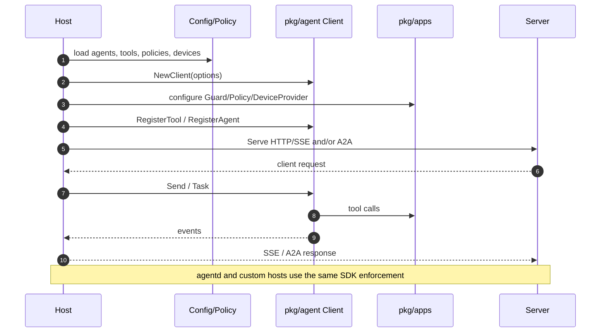
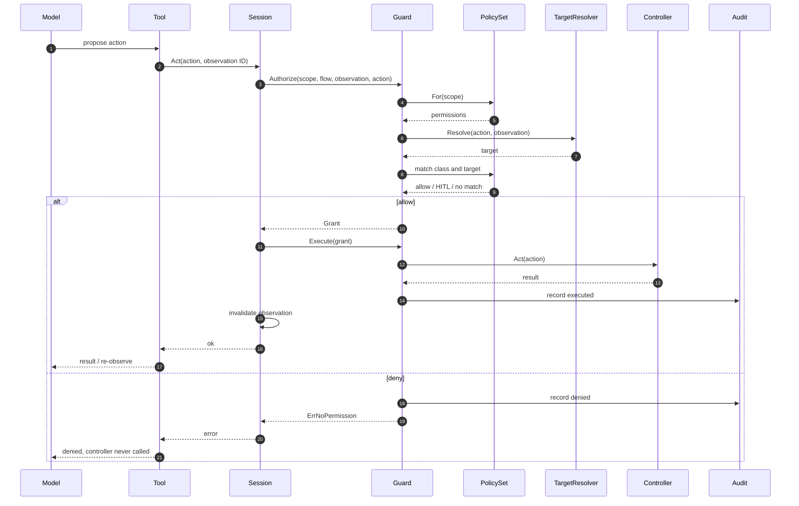
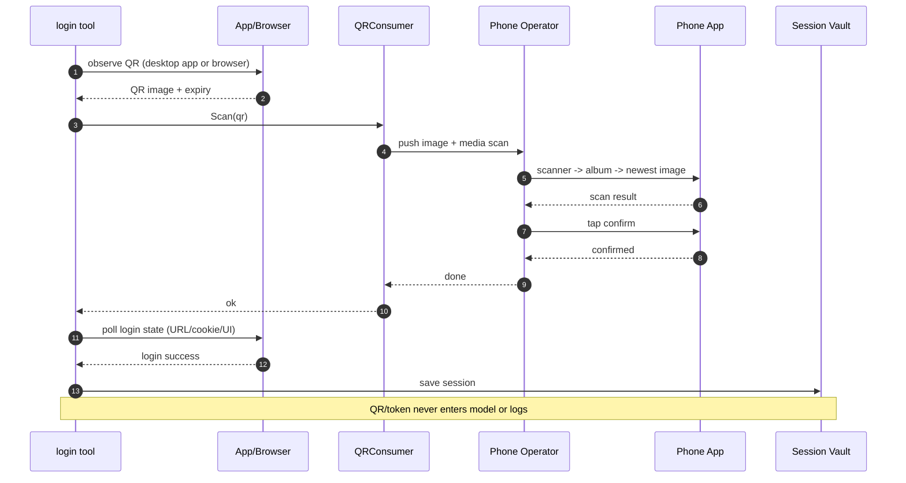
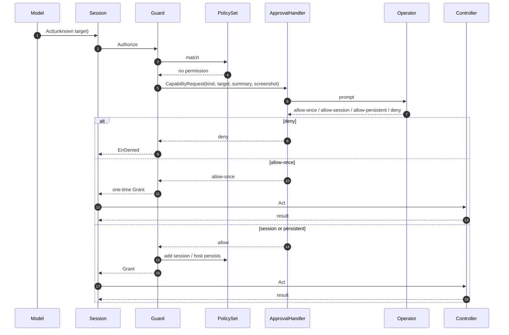
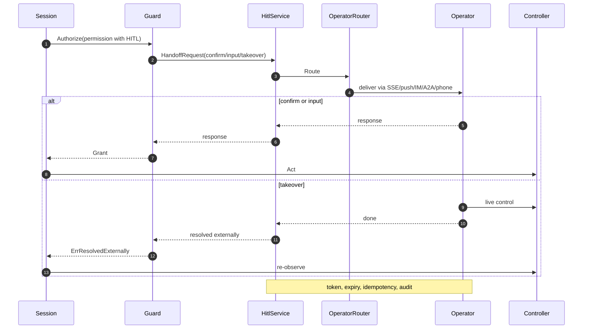
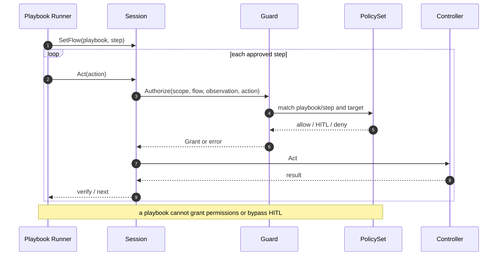
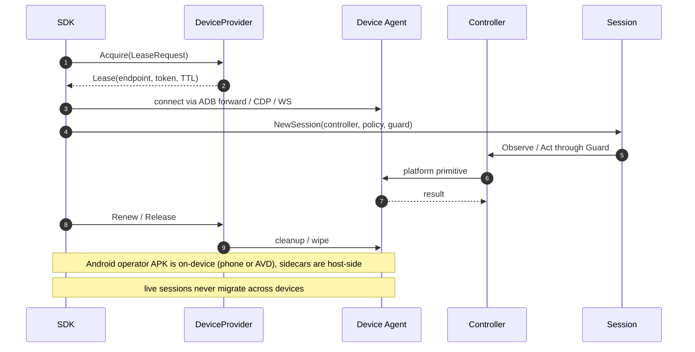
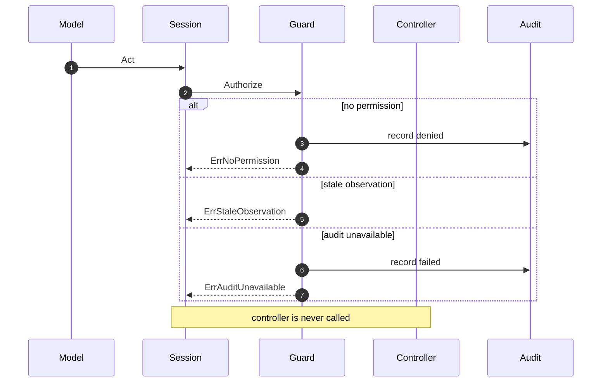
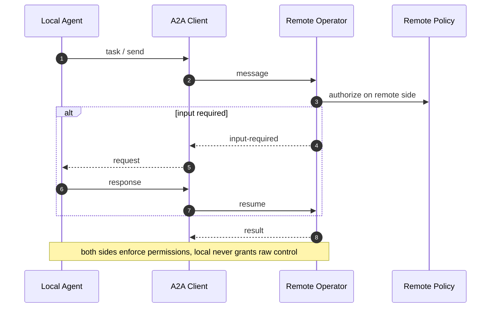
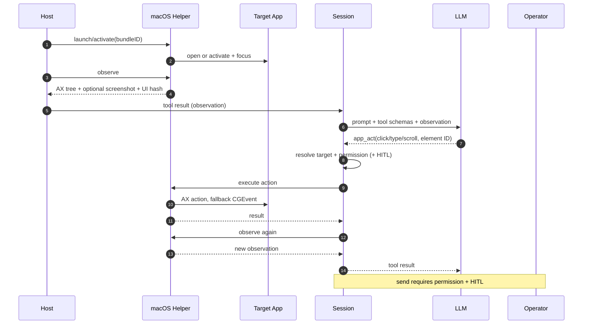

# go-agent-sdk computer-use agents — design

> Status: **draft**. This document designs agents that operate **web, Android and PC**
> applications (Windows, Linux, macOS) and super-app programs (WeChat/Alipay mini-programs
> and official accounts). The **MVP is macOS desktop 企业微信/个人微信** (observe/control; read-only
> default, send with HITL); later phases extend the same model to web, Android and other PC OSes.
> Relationship: computer use has **no counterpart** in opencode TS. It is a Go-specific
> capability; the TS porting rules do not apply. It is a sub-volume of `docs/DESIGN.md` and uses
> the existing `Client` / tools / `task` / permission / A2A seams without changing the core loop.

## Change log

| Date | Change |
|---|---|
| 2026-10-18 | First draft: capability ladder, platform matrix, login/session, playbooks, agent preset, safety, web+QR MVP (QQ Mail / POE). |
| 2026-10-18 | Add challenge/step-up model (`ChallengeResolver`), define "zero-human" as unattended inside a pre-provisioned trusted envelope, and clarify which challenges are resolvable vs. hard stops. |
| 2026-10-18 | Separate **mechanism** from **policy**: the SDK implements primitives, action classification, policy enforcement and audit; per-app behavior (read-only, allowed actions, HITL, rates) is host configuration, not SDK code. |
| 2026-10-18 | Add the `HitlService` handoff mechanism: confirm/input/takeover, operator routing, channels, pending store, resumption and audit. |
| 2026-10-18 | Make constraints **systemic**, not prompt-based: guarded `Session`, no raw driver, pre-controller enforcement, no co-registered raw tools, adversarial tests. |
| 2026-10-18 | Replace read/write with **multi-dimensional risk** (`intent`/`stage`/`effect`/`data`/`sideEffect`/`scope`/`confidence`); trusted app/domain classification rules; unknown/low confidence fails closed. |
| 2026-10-18 | Replace semantic classification with **explicit permissions + JIT approval**. Deployment decides prompt/remember/bypass; dev/test bypass is explicit, scoped, expiring and audited. |
| 2026-10-18 | Add `DefaultGuardConfig` (guided/deny/session) and an explicit `DevBypass()` test helper; no env-driven bypass. |
| 2026-10-18 | Add S1 (Taiyuan travel) and S2 (shopping) usage scenarios with acceptance IDs and capability/phase mapping for code validation. |
| 2026-10-18 | Add the cross-platform **control model** (§5.7) and Android/Windows native-vs-agent/sidecar trade-offs (§5.2.1/§5.3.1). |
| 2026-10-18 | Add runtime/deployment options (§17): web local/remote, Android real/emulator/cloud + QR camera methods, Windows/Linux/macOS interactive-session constraints, HITL transports and environment matrix. |
| 2026-10-18 | Add AVD-in-CI details (§17.2.1) and cloud-vs-self-hosted device pool guidance (§17.7.1). |
| 2026-10-18 | Add an AVD CI workflow example (§17.2.2) and the `DeviceProvider`/lease protocol (§17.7.2). |
| 2026-10-18 | Add system architecture (component/trust/deployment views) and core sequence flows (§3.1–§3.5). |
| 2026-10-18 | Clarify the host/exposure model: **agentd** (HTTP/SSE/A2A) and **custom Go agents** are hosts; HTTP/A2A/MCP are protocols/adapters. Add F0 host startup. |
| 2026-10-18 | Clarify Android placement: host-side **Android controller** on the PC/server vs **on-device operator APK** inside the phone/emulator (§5.2.2). |
| 2026-10-18 | Add emulator-backed apps as a first-class `DeviceProvider` backend (§5.2.3): app + optional operator APK in an AVD, controlled via ADB. |
| 2026-10-18 | Update the §3.2 component view with the `DeviceProvider`/lease layer and explicit Android physical/AVD, browser and sidecar backends. |
| 2026-10-18 | **Change the MVP to macOS desktop 企业微信/个人微信 via UI automation** (AX/CGEvent; no WeCom API dependency; read-only default; send with HITL). Web/Android/Windows/Linux move post-MVP. |
| 2026-10-18 | Add §10.6 end-to-end macOS walkthrough: launch → observe → LLM tool call → Guard → AX/CGEvent act → verify. |
| 2026-10-18 | Review fixes: audit/capability packets no raw text; richer `Element` (Value/Focused/Selected/Visible); `Observation` window; macOS helper protocol; MVP/package-tree consistency. |
| 2026-10-18 | Completeness pass: threat model, macOS app sessions, app-profile schema, failure/recovery matrix, metrics, typed macOS errors, and pre-P0 open items. |

## 0. Positioning

**Goal.** Let an SDK agent observe and operate apps on any platform, so information locked in
vertical apps becomes usable for automated decisions.

**Baseline (safe).** Imitate a human: look at the UI, then act on it. No injection, no hooks, no
bypassing authentication.

**Optimization (layered).** On top of the safe baseline, use structured and deterministic
channels where available: official APIs, the app's own web/DOM/accessibility, system automation
APIs, and recorded playbooks. Vision is the fallback for opaque UIs.

**What the SDK provides.** The capability framework: controllers, normalized observation/action,
tiered routing, session vault, QR/login orchestration, tools, a **policy engine**, and an agent
preset. Hosts provide devices, accounts, consent, any managed phone/device fleet, and the **policy**.

**Mechanism vs. policy.** This document designs mechanisms, not app policy:

| Layer | Owner | Examples |
|---|---|---|
| Mechanism | SDK | observe, click, type, scroll, navigate, session, challenge, HITL, **policy enforcement**, audit |
| Policy | host/user (`ConfigDirs`) | **which apps are usable on each platform/device**, concrete permissions, HITL, limits, deployment prompt/bypass |
| Skill/playbook | host/user (`ConfigDirs`) | how to do a task on a specific app (selectors, steps, assertions) |

The SDK does **not** hardcode "12306 is read-only" or "Taobao may pay". Those are sample permission sets.
The same applies to **which apps a device may use**: *installed does not mean allowed*. Each
platform/device has a preconfigured app inventory and permission policy; the agent cannot
discover and grant itself new apps or permissions. The SDK guarantees that every launch and action
is target-resolved, permission-checked, optionally HITL-gated, and audited (§4.3, §9).

**Enforcement, not prompting.** The policy is a code-side object checked **before** the controller.
Prompt instructions and the model's compliance are not the security boundary; a denied action never
reaches the driver.

**Non-goals.**

- The SDK does not ship protocol reverse engineering, biometric/face bypass, a dedicated captcha
  solver, or anti-bot evasion. A host may opt into a bounded generic `ChallengeVisual` attempt
  (§6.5) or integrate external services, at its own legal/account risk.
- No built-in account/device farm; no credential storage in the SDK's model context.
- Do not put platform drivers in `pkg/core` or the default built-in agent list.
- The MVP operates **macOS 企业微信/个人微信 only**; web, Android, Windows, Linux and mini-programs
  are post-MVP. It establishes the seams for them.

**Zero-human boundary.** "Zero-human" means unattended **inside a pre-provisioned trusted
envelope** (device, account, session, network), not "any account, forever, without a human".
Challenges that deliberately distinguish humans from automation (biometrics/face, CAPTCHA,
protocol signing, anti-bot) are not automated **by default**; a host may opt into `ChallengeVisual`
for CAPTCHA at its own risk. Challenges that can be satisfied with host-owned credentials/devices
(TOTP, email/SMS OTP, push confirm, QR) are resolved automatically. See §6.5.

## 1. The problem and the safe baseline

Vertical apps expose no public API for the data they hold; many require a login (password, SMS,
QR scanned by a mobile app, or biometrics). The safe, universal way to reach them is:

```text
observe (UI tree / DOM / screenshot) -> decide -> act (click / type / scroll)
        ^                                              |
        +------------- verify the new state <----------+
```

One action per step, a new observation after each action, and a human-in-the-loop (HITL) stop
where the deployment requires it (e.g. authentication, payment, irreversible targets).

## 2. Capability ladder

Every step is routed to the cheapest safe tier available for the current app/screen.

| Tier | Mechanism | Cost / speed | Accuracy | Safety | Use when |
|---|---|---|---|---|---|
| **L0** | Official API / open platform / feed | lowest / fastest | highest | highest | the information owner exposes an API |
| **L1** | App/DOM/accessibility/network API, system automation | low | high | high | web DOM, accessibility tree, CDP network, UIA/AT-SPI/AX |
| **L2** | Deterministic playbook (selectors, steps, state assertions) | low (almost no LLM) | high | high (reviewable) | repeated flows, stable apps |
| **L3** | OCR/UI-element detection + Set-of-Marks + small model | medium | medium-high | medium-high | mini-programs, canvas, missing accessibility |
| **L4** | Full-screen vision + large model | high (tokens/latency) | medium | medium | unknown/opaque screens (baseline) |
| **L5** | Human takeover (HITL) | manual | highest | highest | biometrics/CAPTCHA/new-device step-up/payment/irreversible |

Routing rules:

- Prefer L0/L1 structured targets; fall back to L2; then L3; then L4.
- Desktop WeCom/WeChat MVP: **L1 AX is primary**; WeCom L0 APIs cover only server-side/enterprise
  data/actions, not the desktop UI; personal WeChat has no L0. Screenshot/vision is the L3/L4
  fallback **within** UI automation.
- Authentication, payment, deletion, permission grants, and any irreversible action go to L5
  unless the host explicitly grants an automation policy.
- Verification after each action uses the cheapest available signal (DOM mutation, accessibility
  event, network idle, key text), not a screenshot by default.
- Confidence thresholds and repeated no-op detection escalate a tier or stop.
- QR is **not** itself a hard stop: it is resolved by `QRConsumer` (§6.3/§6.5). Biometrics are hard
  stops; CAPTCHA defaults to stop/HITL and is only attempted under an explicit `visual` policy.

## 3. Architecture

```text
pkg/apps/                          // optional, public capability package
  controller.go                    // normalized interfaces + capabilities
  guard.go                         // Session + Guard (the only execution choke point)
  device.go                        // Device, DeviceProvider, Lease
  router.go                        // L0..L5 routing, confidence, fallback
  session/                          // session vault, login state machine
  qr/                              // QR challenge + QRConsumer seam
  hitl/                            // handoff service, channels, pending store, resumption
  policy/                          // permissions, target matching, grants, enforcement, audit
  playbook/                        // versioned deterministic flows
  browser/                         // CDP (post-MVP)
  android/                         // ADB / uiautomator / emulator / phone operator (post-MVP)
  macos/                           // AX/CGEvent helper + WeCom/WeChat profiles (MVP)
  pc/                              // build-tagged: windows, linux (post-MVP)
  tools/                           // app_* / macos_* / web_* / auth_* tools
  operator/                        // macOS WeCom/WeChat preset (MVP)
```

Existing SDK seams used as-is:

- `ClientOptions.Tools` / `PluginConfig.Tools` for tool registration;
- `ClientOptions.MCP` to attach an external device service;
- `AgentConfig.Backend = a2a` / `peers` for remote autonomous operators;
- `task` for delegation, `question`/`permission` for HITL, `Client.On`/SSE for events;
- `ConfigDirs` for agent definitions, skills, playbooks and **policies**.

No core changes. The app-control packages are imported only by hosts that opt in, so platform
dependencies do not affect other users.

### 3.1 Hosts and exposure surfaces

The SDK is a library; there is **no required daemon**. A **host** embeds `pkg/agent` (and
optionally `pkg/apps`) and decides how to expose it:

1. **agentd** (reference host, `cmd/agentd`): embeds the SDK; exposes **HTTP/SSE and/or A2A**;
   loads `cmd/agentd/config` (servers, agents, peers, tools, policies, devices); one client/session
   per configured server. It is the standalone service for non-Go hosts and remote peers.
2. **Custom Go agent**: a Go application imports `pkg/agent` + `pkg/apps`; registers tools/agents,
   configures policies/devices/secrets, and exposes its own API (HTTP/gRPC/CLI/UI) and optional
   A2A/MCP. This is the most flexible path; agentd is essentially a reference implementation.
3. **CLI/test harness**: embeds the SDK; no server; fake controllers and `DevBypass` for tests.

Protocols/adapters are **not** hosts:

| Surface | Role | Host? |
|---|---|---|
| HTTP/SSE (`pkg/server`) | non-Go clients, streaming events | no, transport |
| A2A (`pkg/a2a`) | inbound AgentCard/server + outbound peers | no, protocol |
| MCP (`pkg/mcp`) | tool/device integration (client) | no, integration |
| CLI | local UI | no, client |

| Exposure | Built by | Transport | Typical use | Authority |
|---|---|---|---|---|
| agentd | SDK repo | HTTP/SSE, A2A | standalone, non-Go, remote peers | agentd config + `ConfigDirs` |
| Custom agent | host developer | any | product embedding | host code + `ConfigDirs` |
| CLI/test | host developer | stdio | dev/test | fake/`DevBypass` |
| Remote operator | host developer | A2A/MCP | delegation | both sides enforce |
| MCP server | host/third party | MCP | tools/devices | host config |

```text
agentd (HTTP/SSE/A2A) ─┐
custom Go agent ───────┼─> pkg/agent (Client/Tools/Task) ─> pkg/apps
CLI/test harness ──────┘                                   ├─ policy/guard
                                                           ├─ devices/browser
                                                           └─ HITL/audit
        │
        ├─ pkg/server (HTTP/SSE)
        ├─ pkg/a2a (inbound server / outbound client)
        └─ pkg/mcp (client)
```

Rules:

- Exposure is explicit: agentd enables transports through config; a custom agent enables its own.
- A2A inbound/outbound is a protocol; MCP is a tool/device seam; neither is an agent host.
- A custom agent that exposes A2A/MCP still uses the same `pkg/apps` policy/guard; it does not
  bypass enforcement.
- agentd is the reference host, not a required runtime.
- **MVP**: a custom Go agent or agentd using the macOS signed helper (§5.5); Web/Android backends
  are post-MVP.

#### 3.1.1 Host contract

Startup order (fail closed):

1. Load `ConfigDirs`/agentd config (agents, tools, policies, devices, peers).
2. Compile and validate policies and device inventory; any unsafe/unknown entry stops startup.
3. Construct `agent.Client`, register tools/agents, construct `Guard`/`DeviceProvider`/HITL/audit.
4. Start transports (HTTP/SSE and/or A2A) **only after** validation succeeds.
5. Expose health/readiness; on shutdown stop accepting work, drain sessions and release leases.

Isolation and lifecycle:

- One session per client/task; policy snapshot per session; account/device affinity.
- Tenant isolation: no cross-session vault, QR image, credential or device leakage.
- Quotas/backpressure/cancellation for model calls, tools and devices.
- Policy/device changes apply to **new** sessions; running sessions keep their snapshot and are
  audited.

Exposure security:

| Exposure | Auth/authorization | Streaming | HITL | Remote peers |
|---|---|---|---|---|
| agentd HTTP/SSE | host auth/TLS; tenant scopes | SSE | SSE/question/takeover | via A2A |
| agentd A2A | A2A auth + AgentCard | task events | `input-required` | A2A peers |
| Custom agent | host-defined | host-defined | host-defined | optional |
| MCP client | trusted server config | tool calls | n/a | external tools/devices |

- HTTP: authenticate/authorize clients, TLS/mTLS, rate limits, CORS; never expose raw drivers.
- A2A: publish an AgentCard with real skills; enforce auth; map HITL to `input-required`.
- MCP: only attach trusted servers; never co-register raw-control MCP servers with computer use.
- CLI: local-user trust; still subject to the same Guard/Policy.

Capability discovery exposes **skills/tools filtered by policy**, never device handles, grants or
credentials. Errors map to HTTP/A2A task states without secrets; denied actions remain auditable.

### 3.2 Component view

```text
┌────────────────────────────────────────────────────────────────────┐
│ Hosts: agentd (HTTP/SSE/A2A) | custom Go agent | CLI/tests          │
│ config, policy, secrets, operator UI, deployment                   │
└───────────────────────────────┬────────────────────────────────────┘
                                │
┌───────────────────────────────▼────────────────────────────────────┐
│ pkg/agent: Client / Session / Tools / Task                          │
│ model loop, tool registry, events, subagents                       │
└───────────────────────────────┬────────────────────────────────────┘
                                │ app_* / web_* / auth_* tools
┌───────────────────────────────▼────────────────────────────────────┐
│ pkg/apps: Session -> Guard -> Permission -> TargetResolver          │
│ HITL/Approval | Audit | Redactor | SecretStore | Playbook           │
│ QRConsumer | SessionVault | ProfileStore | Handoff                  │
└───────────────────────────────┬────────────────────────────────────┘
                                │
┌───────────────────────────────▼────────────────────────────────────┐
│ DeviceProvider / Lease: local pool | AVD pool | cloud | reserved    │
└───┬────────────────┬───────────────────┬───────────────────┬───────┘
    │                │                   │                   │
    ▼                ▼                   ▼                   ▼
 WebController    AndroidController    PCController       MCP/A2A adapters
 (post-MVP)       (post-MVP)           (macOS MVP)        tools/peers
    │ CDP             │ ADB               │ IPC
    ▼                 ▼                   ▼
 Local Chromium   Physical phone       Windows sidecar
 /remote browser  (operator APK)       FlaUI/UIA
                  AVD/emulator         Linux helper (post-MVP)
                  (app + optional      macOS helper (MVP)
                   operator APK)       (AX/CGEvent)
```

| Layer | Components | Responsibility | Trust |
|---|---|---|---|
| Hosts | agentd, custom Go agent, CLI/tests | exposure, lifecycle, config | trusted |
| Protocols | HTTP/SSE, A2A, MCP | transport/adapters | boundary |
| Agent | `Client`, session runner, tools, `task` | model loop and tool calls | code trusted; model args untrusted |
| Apps | `Session`, `Guard`, permissions, target resolver | execution choke point | trusted |
| Services | HITL/approval, audit, redactor, secret store, playbook, vault | policy/HITL/observability | trusted |
| Device control | `BrowserController`, `AndroidController`, `PCController`, MCP/A2A adapters | host-side I/O | trusted, narrow |
| Device backends | local/remote browser, physical phone, AVD/emulator, Windows sidecar, Linux/macOS helper, cloud farm | actual UI/device | trusted per host config; content untrusted |
| External | app/web content, LLM | content/data | untrusted |

### 3.3 Trust boundaries and data flow

```text
Untrusted model
  │ tool args (schema-validated)
  ▼
Trusted guard: resolve -> permission -> HITL/secret -> audit
  │ resolved action + single-use grant
  ▼
Trusted driver: CDP / ADB / UIA / AT-SPI / AX (narrow)
  │
  ▼
Untrusted app/website content (data, not instructions)
```

Core data flow:

```text
Observe -> normalize/redact -> model -> Action -> resolve target
  -> Permission (allow/deny/HITL) -> execute -> verify -> re-observe
```

Invariants:

- The model cannot add permissions, grants or target fields; it proposes actions only.
- The guard/policy are in the execution path; prompts are advisory.
- Web page/app text is untrusted data; prompt injection cannot change authority.
- Remote/A2A/MCP workers must run the same enforcement on their side; the local side never grants
  raw control.

### 3.4 Deployment topologies

| Topology | Host / exposure | Components | Pros | Cons |
|---|---|---|---|---|
| **macOS WeCom/WeChat (MVP)** | custom agent/agentd; local | macOS helper + AX/CGEvent | simple; testable | single-OS |
| Embedded custom agent | custom Go agent; own API/UI | SDK + local macOS/PC | simple; low latency | scale/OS limits |
| agentd HTTP/SSE | agentd; HTTP/SSE | SDK + browser/device pool | non-Go clients; streaming | service ops |
| agentd A2A | agentd; A2A server | SDK + AgentCard/peers | remote agents; standard | A2A semantics/latency |
| agentd + custom peers | agentd; HTTP/SSE + A2A | local agent + remote policy | delegation; hybrid | double enforcement |
| Remote browser | agentd/custom; CDP WS | browser container + HITL | isolation; scale | network/state/version |
| Emulator pool | agentd/custom; provider | AVD/Docker-Android + host controller | cheap; parallel; snapshots | detection/resources |
| Device pool/cloud | agentd/custom; provider API | `DeviceProvider` + agents/sidecars | scale; authentic devices | ops/cost/privacy |
| Supervisor | `agentd-supervisor` | process lifecycle | crash recovery | not an agent host |

The controller interface is identical across topologies; only `Lease.Endpoint` and the transport
change. A2A/MCP are **not** topologies by themselves: they are exposed by agentd or a custom host,
or used as client integrations.

### 3.5 Core sequence flows

Mermaid diagrams; view in a renderer that supports Mermaid.

| Flow | Purpose | Key invariant |
|---|---|---|
| F0 | host startup/exposure | policy/devices loaded before serving |
| F1 | observe/act loop | no permission → no controller call |
| F2 | QR login + phone operator | QR/token never enters model/logs |
| F3 | JIT permission | model proposes; human approves/persists |
| F4 | HITL confirm/input/takeover | exact target; expiry; idempotent |
| F5 | approved playbook | cannot grant permissions or bypass HITL |
| F6 | lease + platform controller | no live session migration |
| F7 | fail-closed | deny/stale/audit stop before I/O |
| F8 | remote/A2A operator | both sides enforce permissions |

#### F0: host startup and exposure



#### F1: observe → act → verify



#### F2: QR login + phone operator



#### F3: JIT permission approval



#### F4: HITL confirm/input/takeover



#### F5: approved playbook



#### F6: device lease + platform controller



#### F7: fail-closed paths



#### F8: remote/A2A operator



## 4. Core interfaces (illustrative)

```go
// Controller is the low-level driver for one connected app surface.
// Adapter authors implement it; agents/tools never receive it directly.
type Controller interface {
    Capabilities() Capabilities
    Observe(ctx context.Context) (Observation, error)
    Act(ctx context.Context, action Action) error
    Screenshot(ctx context.Context, clip *Rect) ([]byte, error)
    Close() error
}

type Capabilities struct {
    API         bool // structured app API / network data
    DOM         bool // browser DOM
    A11y        bool // accessibility tree
    Vision      bool // screenshots usable
    OCR         bool
    Coordinates bool // absolute input
    Keyboard    bool
    Touch       bool
    Navigate    bool // URL/tab navigation
    Network     bool // read XHR/fetch
    Script      bool // JS evaluation (high risk)
    Clipboard   bool
    File        bool // upload/download
    Notify      bool // notifications/SMS
    AppLaunch   bool
}

type Observation struct {
    ID       string             // fingerprint of this UI state; binds actions to it
    Platform string
    App      string
    Window   string             // active window title
    WindowID string
    URL      string             // web only
    Title    string
    Elements []Element          // normalized, with bounds and actions
    Text     string             // visible-text summary
    Network  []NetworkCall      // recent XHR/fetch responses (optional)
    QR       *QRChallenge       // detected login QR (optional)
    Image    []byte             // only for L3/L4 or user display
}

type Element struct {
    ID          string
    Role        string
    Subrole     string
    Name        string
    Description string
    Text        string // visible text
    Value       string // field/composer value; redact before model
    Placeholder string
    Bounds      Rect
    Enabled     bool
    Visible     bool
    Focused     bool
    Selected    bool
    Clickable   bool
    Actions     []string
    Children    []Element
}

type Point struct{ X, Y float64 } // normalized 0..1, converted per platform

type Action struct {
    Kind          string  // click/doubleClick/rightClick/hover/fill/type/key/scroll/drag/
                          // select/upload/download/navigate/back/forward/reload/tab/window/app/wait
    ObservationID string  // required for element/selector/box targets; must match Observation.ID
    Selector      string  // DOM/playbook selector
    Element       string  // normalized element id
    Box           *int    // Set-of-Marks index; nil if unused
    Text          string
    Secret        bool    // text is sensitive; controllers must not log it
    Key           string
    Point         *Point  // nil unless coordinate input
    To            *Rect   // drag destination; nil unless dragging
    URL           string
}
```

The primitive surface (all policy-gated):

| Observe | Act | Verify |
|---|---|---|
| DOM, accessibility, screenshot, OCR/element detection, visible text, network, clipboard, notifications | click/double-click/right-click/hover, drag, scroll, type, key/hotkey, paste, select, upload/download, navigate/back/forward/reload, tab/window/app, wait | DOM mutation, network idle, URL/title, expected text, screenshot diff |

Session (profiles/cookies/login), challenge (resolver/visual/HITL) and artifact handoff are also
mechanisms; they are not app policy.

### 4.1 Action primitives and target resolution

The model proposes an action; the trusted adapter resolves it to a concrete **target**. There is
no global read/write or risk taxonomy: authorization matches the exact action + target against
explicit permissions.

```go
type ActionClass string // observe | navigate | pointer | input | secret | script | file |
                        // clipboard | session | window | app | challenge

type ActionTarget struct {
    App, URL, Package, Window            string
    Selector, Element, Label, Role, Key  string
    Region                               *Rect
}

type TargetResolver interface {
    Resolve(ctx context.Context, scope Scope, obs Observation, a Action) (ActionTarget, error)
}
```

- Exactly one target form is allowed (`selector` | `element` | `box` | `point` | `url`);
  multiple/ambiguous -> `ErrUnresolved`. A selector/element/box must resolve to exactly one
  element in the bound observation; zero or multiple matches fail closed.
- The resolver fills target attributes from the trusted observation/config: URL, package, window
  class, selector, element id, label, role, key. Labels are convenient but locale/UI-dependent;
  prefer stable selectors/roles/URLs where possible.
- The model cannot add target attributes or grant permissions; it can only propose an `Action`.
- Raw coordinates resolve to a `Region` target; a permission must explicitly allow coordinate
  input, otherwise it is denied.
- `Action.Secret` marks sensitive text; controllers must not log it.

### 4.2 Permissions, grants, and enforcement

```go
type Scope struct {
    Platform, Device, App string
}

type TargetMatcher struct {
    App, URL, Package, Window           string
    Selector, Element, Label, Role, Key string
    Region                              *Rect
}

type Limits struct {
    MaxUses   int
    Rate      RateLimit
    ExpiresAt time.Time
}

type Permission struct {
    ID       string
    Class    ActionClass // observe/navigate/pointer/input/secret/script/file/...
    Kind     string      // specific primitive; empty = any in class
    Playbook string      // optional: only within this approved playbook
    Step     string      // optional: only this step
    Target   TargetMatcher
    Limits   Limits
    HITL     bool
}

type Mode string // observe-only | playbook-only | guided

type UnknownPolicy string  // deny | prompt
type RememberPolicy string // none | session | persistent

const (
    ObserveOnly Mode = "observe-only"
    PlaybookOnly Mode = "playbook-only"
    Guided       Mode = "guided"

    Deny   UnknownPolicy = "deny"
    Prompt UnknownPolicy = "prompt"

    RememberNone       RememberPolicy = "none"
    RememberSession    RememberPolicy = "session"
    RememberPersistent RememberPolicy = "persistent"
)

type Policy struct {
    Mode        Mode
    OnUnknown   UnknownPolicy   // per-app override; GuardConfig provides the default
    Remember    RememberPolicy
    Rate        RateLimit       // default rate for permissions
    Permissions []Permission
    Playbooks   []string        // allow-listed playbook IDs
}

type PolicySet interface {
    For(scope Scope) (Policy, error) // ErrNoPolicy if the device/app is not configured
}

type CapabilityRequest struct {
    ID         string
    Scope      Scope
    Kind       string
    Class      ActionClass
    Target     ActionTarget
    Summary    string // redacted action description; never secret text
    Screenshot []byte
    Reason     string
    ExpiresAt  time.Time
}

type Approval struct {
    Decision string // allow-once | allow-session | allow-persistent | deny
    Operator string
}

type ApprovalHandler interface {
    Approve(ctx context.Context, req CapabilityRequest) (Approval, error)
}

type Grant struct { /* opaque: permission, target, flow, expiry, atomic used */ }
```

The effective capability set is `Capabilities ∩ Policy`. Every primitive goes through one choke
point:

```text
Action -> resolve target -> Policy.For(scope) -> match Permission -> allow/HITL/deny -> Act -> audit
```

- A permission matches when its class/kind matches, its optional `Playbook`/`Step` matches the
  trusted `FlowContext`, and **every non-empty target field** matches the resolved target. The most
  specific match wins; equal specificity uses the first match.
- No matching permission is **not** inferred as read/write: the deployment chooses `OnUnknown`
  (`deny` or `prompt`). There is no default allow.
- Modes:
  - `observe-only`: only `observe`/`navigate` permissions are effective.
  - `playbook-only`: `flow.Playbook` must be allow-listed; only permissions with matching
    `Playbook`/`Step` are considered; ad-hoc actions are denied.
  - `guided`: preconfigured permissions + JIT for unknown targets.
- **Bypass** is a separate `GuardConfig.Bypass.Enabled` switch (development/testing only); it
  skips permission/HITL checks, but audit/redaction/secret handling and the no-raw-driver rule
  still apply.
- JIT (`OnUnknown=prompt`):
  ```text
  no match -> CapabilityRequest (kind/target/summary/screenshot) -> ApprovalHandler
    allow-once       -> one-time Grant
    allow-session    -> in-memory Permission for this session
    allow-persistent -> host writes the permission (versioned/audited)
    deny             -> ErrDenied
  ```
  The model may **propose** the action; only the human/host approves and persists.
- `Policy` also gates app launch/close, window/tab switching, navigation, JS, clipboard, file
  upload/download, session export/import and HITL responses. `AppList` is filtered by the device
  inventory; installed ≠ allowed.
- Limits (`MaxUses`, `Rate`, `ExpiresAt`) are enforced here, not in prompts.
- Unknown actions/targets fail closed and are audited.

#### Hard enforcement, not prompting

The policy is **code/data in the execution path**; prompts are advisory. The model is untrusted;
the tool schema, guard and policy are trusted. The model cannot bypass them by instruction, prompt
injection, tool choice, or raw driver access.

- Tools never expose raw drivers/handles. `Open` returns a **guarded `Session`**; agents/tools
  receive only `Session`. `Controller` is the adapter contract for platform packages; a host that
  drives a `Controller` directly opts out of the SDK's policy guarantee. The public API has no
  `Unsafe()`/`Raw()` escape. Tools may only compose guarded primitives; they never call drivers
  directly.
- Every tool call is schema-validated, target-resolved and permission-checked **before** the
  controller is called. A denied action returns `ErrDenied`; the controller is **never invoked**;
  the denial is audited.
- The tool list is filtered by policy at session start: fully denied tools are not advertised. A
  hallucinated tool still fails closed.
- Unknown tool/action/target fails closed. The model cannot register tools or alter policy.
- `script`, `file`, `clipboard`, `session`, app install, global keyboard and raw coordinates are
  separate capabilities, default-deny; they are not reachable through `app_act`.
- Do not co-register unrestricted shell/file/JS tools with a computer-use agent. The same applies
  to MCP/external tools that expose raw device/browser control. If such tools are registered, they
  are separate capabilities with their own policy/sandbox; otherwise the model can bypass the
  guarded session through them.
- The model may be told the rules for UX, but correctness **does not depend on it**. Prompt
  injection in page content is data; policy still blocks the resulting action.
- Subagents/`task` inherit the same or a narrower policy; a child cannot escalate. A2A/MCP/remote
  operators must run the same enforcement on their side; the local side never grants raw control.
- Defense in depth: the SDK guard is primary; controller-level checks and OS/browser permissions
  (Android app ops, browser permissions, OS ACLs) are additional backstops.

### 4.3 Deployment configuration

Policies are explicit **permissions**, loaded from `ConfigDirs` (or constructed by the host),
versioned and audited. A policy is scoped **platform → device → app**; "app" means a web origin,
an Android package/activity, a Windows executable/window class, a macOS bundle ID, a Linux desktop
entry/AT-SPI name, or a host app + mini-program appID. The app inventory is preconfigured: an
installed app is not usable until it is listed and allowed. The runtime resolves the applicable
policy by `platform`+`device`+`app` before every action; an unknown device/app has no policy and
is denied. The policy set is **immutable for a session**; changes take effect on the next session
or an explicit host reload, and are versioned/audited. Policy files live outside the agent's
writable workspace and are not exposed through file tools.

```go
type Device interface {
    Platform() string
    Apps() []AppInfo // policy-filtered inventory; no unlisted app
    Launch(ctx context.Context, appID string) (*Session, error)
}
```

`Launch` re-checks policy; it is impossible to obtain a controller for an app that is not in the
device's inventory.

| Platform | App matcher |
|---|---|
| Web | origin/URL |
| Android | package + activity |
| Windows | executable + window class/UIA name |
| macOS | bundle ID + AX role |
| Linux | desktop entry + AT-SPI name |
| WeChat/Alipay | host package + mini-program appID/path |

The SDK defines the mechanism; the deployment decides prompt behavior, remembering and bypass:

```go
type GuardConfig struct {
    Mode      Mode            // observe-only | playbook-only | guided
    OnUnknown UnknownPolicy    // deny (default) | prompt
    Remember  RememberPolicy   // none | session | persistent
    Approvals ApprovalHandler
    Bypass    *BypassConfig
}

func DefaultGuardConfig() GuardConfig {
    return GuardConfig{Mode: Guided, OnUnknown: Deny, Remember: RememberSession}
}

type BypassConfig struct {
    Enabled   bool
    Reason    string
    Scope     []string // optional app/device IDs; empty = all
    ExpiresAt time.Time
}

// DevBypass is an explicit host helper for tests; it is not env-driven and not
// available to the model. It still produces an auditable bypass grant.
func DevBypass() *BypassConfig {
    return &BypassConfig{
        Enabled:   true,
        Reason:    "dev/test",
        ExpiresAt: time.Now().Add(time.Hour),
    }
}
```

A per-app `Policy` may override `Mode`/`OnUnknown`/`Remember`; empty fields inherit
`GuardConfig`, which supplies the deployment defaults. `bypass` is valid only in `GuardConfig`,
never in a per-app policy.

- **Production default**: `Mode: guided`, `OnUnknown: deny`, `Remember: session`, `Bypass: nil`.
  `prompt` is an explicit opt-in. The zero value normalizes to conservative (`Mode=""` ->
  observe-only, `OnUnknown=""` -> deny, `Remember=""` -> none, no bypass);
  `DefaultGuardConfig()` returns the production default.
- **Development/testing**: `Bypass: DevBypass()` or `OnUnknown: prompt` + an auto-approving
  `ApprovalHandler`. `DevBypass()` is an explicit call (not env-driven); bypass requires a
  `Reason` and future `ExpiresAt`; it is audited and scoped. Bypass disables permission/HITL
  checks **only**; audit, redaction, secret handling and the no-raw-driver rule still apply.
- **Bypass is never model-controlled**: it is host configuration, not a tool, prompt or policy
  field the agent can edit. Bypass still records the action and, when resolvable, the target;
  unresolved dev actions are audited as unresolved.
- **Prompt UX**: `ApprovalHandler` may offer `allow-once` / `allow-session` /
  `allow-persistent` / `deny`; `Remember` controls which options are offered. Batch/flow approval
  is done by approving a playbook; JIT is for the long tail.
- **No repeated prompts for known targets**: a matching permission executes directly; only
  unknown targets (and `HITL: true` permissions) prompt.

`allow` and `hitl` entries are `Permission`s; `hitl` sets `HITL: true`. Example policy — **not
built-in behavior**:

```yaml
# policies/12306-android.yaml
platform: android
device: phone-1
app: 12306
match:
  package: com.MobileTicket
  activity: com.MobileTicket.MainActivity   # optional
mode: guided
onUnknown: prompt
remember: session
allow:
  - {class: observe}
  - {class: pointer, target: {label: "查询"}}
  - {class: input,   target: {label: "出发地"}}
  - {class: input,   target: {label: "目的地"}}
  - {class: input,   target: {label: "日期"}}
# no submit/order/pay permissions: those targets are denied or prompt JIT
rate: {actionsPerMinute: 30}
```

Development/testing:

```yaml
# configs/dev.yaml (GuardConfig, not a per-app policy)
mode: guided
bypass:
  enabled: true
  reason: "local e2e"
  expiresAt: "2026-10-19T00:00:00Z"
```

`mode` controls `observe-only` / `playbook-only` / `guided`. `Bypass.Enabled` is a separate
dev/test switch that skips permission/HITL checks; it is not a mode and not a per-app policy.

Evaluation is **allow-list only**: no matching permission = deny or JIT prompt. The SDK ships
templates (observe-only, guided, playbook-only, dev bypass) and a validator that warns on unsafe
combinations (bypass without reason/expiry, no audit sink, `script`/`file` without explicit
permissions). It never ships app-specific rules as defaults.

### 4.4 Session and Guard

`Session` is the only execution surface tools/agents receive. It binds scope + controller + guard +
redactor and has **no raw controller accessor**.

```go
type FlowContext struct { // set by the trusted playbook runner, never by the model
    Playbook string
    Step     string
}

type Session struct {
    scope    Scope
    ctrl     Controller // unexported
    guard    *Guard
    redactor Redactor
    // last observation + flow context + mutex
}

func (s *Session) Capabilities() Capabilities
func (s *Session) Observe(ctx context.Context) (Observation, error)
func (s *Session) Act(ctx context.Context, a Action) error
func (s *Session) Screenshot(ctx context.Context, clip *Rect) ([]byte, error)
func (s *Session) Close() error
```

`Observe` calls the controller, then the `Redactor`; the controller sets `Observation.ID` (a DOM/UI
fingerprint), or the session computes a hash of the normalized observation if it is empty. `Act`
requires `Action.ObservationID` to match for element/selector/box targets. After any `Act` that
reaches the controller, the cached observation is invalidated (even on error), so the next element
action needs a fresh `Observe`. The trusted playbook runner sets the session's `FlowContext`; `Act` passes it to
`Authorize`. `Capabilities` returns driver capabilities filtered by coarse policy; `Observe`/
`Screenshot` are `observe` actions, checked by policy and redacted; `Close` is always allowed.

`Guard` owns target resolution, permission matching, JIT approval and audit:

```go
type Guard struct {
    Policies  PolicySet
    Resolver  TargetResolver
    Approvals ApprovalHandler
    Audit     AuditSink
    Redactor  Redactor
    Secrets   SecretStore
    Config    GuardConfig
    Clock     func() time.Time
}

type Grant struct { /* opaque: permission, target, flow, observation ID, expiry, atomic used flag */ }

func (g *Guard) Authorize(ctx context.Context, scope Scope, flow FlowContext, obs Observation, a Action) (*Grant, error)
func (g *Guard) Execute(ctx context.Context, scope Scope, ctrl Controller, obs Observation, grant *Grant) error
```

`Authorize`:

1. Bypass enabled, in scope and unexpired -> attempt target resolution for audit (unresolved is
   audited as unresolved), then issue a bypass `Grant` (skips permission/HITL).
2. Element/selector/box action with missing/mismatched `ObservationID` -> `ErrStaleObservation`.
3. `Policies.For(scope)`; no policy -> `ErrNoPolicy`.
4. `Resolver.Resolve(scope, obs, a)`; ambiguous/unresolvable -> `ErrUnresolved`.
5. Match a `Permission` (class/kind + target; most specific wins); check limits/expiry.
6. No match (policy override, else `Config.OnUnknown`):
   - `OnUnknown=deny` -> `ErrNoPermission`.
   - `OnUnknown=prompt` -> `CapabilityRequest` -> `Approvals.Approve`:
     `allow-once` -> Grant; `allow-session` -> in-memory permission; `allow-persistent` -> host
     writes policy; `deny` -> `ErrDenied`.
7. `HITL: true` permission -> approval per use (or session per `Remember`).
8. Issue a single-use `Grant` bound to scope/flow/observation/target/permission.

`Execute` re-validates expiry/unused/target, obtains a current fingerprint from the controller (or a
short-TTL cache) and compares it with the grant, calls `ctrl.Act` with the raw action bound to the
grant, marks the grant used, and audits. A changed page, missing element or stale fingerprint returns
`ErrStaleObservation`; it never acts on a different target.

Typed errors (model-visible messages contain no secrets):

| Error | Meaning |
|---|---|
| `ErrNoPolicy` | device/app is not configured |
| `ErrNoPermission` | no matching permission and `OnUnknown=deny` |
| `ErrDenied` | user denied the JIT request |
| `ErrUnresolved` | action/target cannot be resolved |
| `ErrStaleObservation` | observation or target changed |
| `ErrBypassExpired` | bypass enabled but expired/out of scope |
| `ErrSecretRequired{Ref}` | use the trusted secret tool |
| `ErrResolvedExternally` | takeover changed state; re-observe |
| `ErrAuditUnavailable` | mutating action blocked because audit failed |
| `ErrTCCDenied` | Accessibility/Screen Recording/Input Monitoring missing |
| `ErrSecureInput` | macOS secure input / lock screen is active |
| `ErrHelperUnavailable` | helper crashed or IPC failed |
| `ErrAppNotRunning` | target app is not running and launch failed |
| `ErrWindowNotFound` | target window disappeared |
| `ErrProfileMismatch` | app build/UI hash does not match the profile |
| `ErrAccountMismatch` | active app account differs from the configured account |
| `ErrLoginRequired` | app is logged out or the session expired |
| `ErrApprovalTimeout` | JIT/HITL approval timed out |
| `ErrSendUnverified` | sent state could not be verified |

Supporting interfaces:

```go
type AuditSink interface {
    Record(ctx context.Context, e AuditEvent) error
}
type Redactor interface {
    Redact(ctx context.Context, scope Scope, obs Observation) (Observation, error)
}
type SecretStore interface {
    Resolve(ctx context.Context, ref string) (Secret, error)
}
type Secret interface {
    Use(func([]byte) error) error // no String/JSON; prevents accidental logging
}

type AuditEvent struct {
    Time         time.Time
    Scope        Scope
    Kind         string
    Class        ActionClass
    Playbook     string
    Step         string
    Target       ActionTarget // labels truncated/redacted
    PermissionID string
    GrantID      string
    Bypass       bool
    Result       string // allowed | denied | prompted | executed | failed
    Operator     string
    Error        string
}
```

Rules:

- `AuditEvent` records kind/class, playbook/step, target, permission/grant, bypass, result, operator
  and error; it **never** records raw `Action.Text`, secrets or full screenshots (hash only).
  Target labels are truncated/redacted.
- If `Redact` fails, `Observe`/`Screenshot` fail: unredacted data is never returned to the model.
- Audit failure **denies** mutating classes (`pointer`/`input`/`secret`/`script`/`file`/
  `clipboard`/`session`/`app`); `observe`/`navigate` may continue with a warning.
- `type_secret` accepts a ref, never a value from the model; the guard resolves and types it, and
  the value never enters the model context or audit. Secret actions set `Action.Secret`; controllers
  must not log or persist the text.
- `CapabilityRequest`/HITL packets use kind/target and a redacted summary; they never include raw
  secret text.
- `FlowContext` is set by the trusted playbook runner, never by the model or the action schema.
  It provides `playbook`/`step` for `playbook-only` matching; there is no semantic risk label.
- `Controller` is the adapter contract; `Session` is the public surface; `Guard` is session-private
  (not exposed to tools); `Grant` is opaque, pointer-based and single-use (atomic flag, no copying).
  A host that drives a `Controller` directly opts out of the policy guarantee.
- Dependency direction: `apps` imports `policy`/`hitl`; those do not import `apps`; platform
  packages implement `Controller`/`Device` and import `apps`. `Scope`/`ActionTarget`/`Permission`
  live in the policy package (or a shared leaf) to avoid cycles.
- After takeover, do **not** execute the old grant: re-observe and re-authorize.

Open trade-offs:

- There is **no universal read/write or risk classification**. Explicit permissions are the
  authority; a new target needs config or a JIT approval. This is the only model that covers
  arbitrary apps without an open-ended ontology.
- Prompt frequency is a **deployment** decision: `OnUnknown=deny` (strict) or `prompt` (guided),
  plus explicit bypass for dev/test. Playbooks reduce prompts by approving a flow once.
- Re-observing on every `Act` is safest but costly. The grant binds to the observation fingerprint
  and `Execute` re-validates the target; a short-TTL controller cache is allowed, but a stale
  fingerprint never executes.
- `confirm`/JIT approval is for the **exact target**; if the page changes during approval, the
  grant is stale and the agent re-plans.
- Bypass is explicit, scoped, expiring and audited; it is never available to the model.

### 4.5 Normalized observation

- Coordinates are **normalized** and converted to device pixels using the controller's scale/DPI;
  never let the model emit raw screen pixels.
- Observation is **bounded**: depth/element/text limits; large lists are summarized or paged. Raw
  AX/DOM is never sent wholesale to the model.
- `Set-of-Marks`: the controller may annotate the screenshot with numbered boxes; the model returns
  a box id. This reduces hallucinated coordinates and makes actions auditable.
- Element actions are capability-driven: DOM click, accessibility action, or coordinate input.
- `Element.Value/Text/Description` may contain PII or secrets; redact before the observation reaches
  the model. `Value/Focused/Selected` are required to understand composers, message lists and
  selection state.

## 5. Platform matrix

| Platform | Observation | Action | Login/session | Dependencies / caveats |
|---|---|---|---|---|
| **Web** | CDP: DOM, Accessibility, Runtime, Network, Console; screenshot | CDP Input (mouse/key), DOM focus/fill, navigation | profiles / `storage_state` / attach to an existing browser; QR | Chromium/Edge; pure Go (chromedp / rod); anti-bot and ToS |
| **Android** | `uiautomator dump`, accessibility service, `screencap` | ADB `input tap/swipe/text/keyevent`, accessibility actions, Appium | app login on the device; QR via a controlled phone; biometrics only pre-provisioned | emulator (AVD / Docker-Android / Cuttlefish) or real device; emulator detection; no universal biometric injection |
| **Windows** | UI Automation (COM), window messages, OCR, screenshot (WGC/DXGI) | SendInput (mouse/key), UIA patterns, `SetCursorPos` | app login; QR via the phone operator; PC client sessions | CGo/COM or a sidecar (e.g. Python `uiautomation`) via MCP; UAC/secure desktop cannot be automated; Electron/UWP/Win32 |
| **Linux** | AT-SPI2 (D-Bus accessibility), X11 window tree, screenshot | X11 XTest; Wayland `ydotool`/`uinput`/`wtype`/libei; AT-SPI actions | app login; browser sessions; QR | no single UIAutomation; Wayland input/portal permissions; AT-SPI support varies (GTK/Qt/Electron); uinput is privileged |
| **macOS** | Accessibility API (`AXUIElement`), AppleScript, ScreenCaptureKit | CGEvent (mouse/key), AX actions, AppleScript | app login; browser profiles; QR | Accessibility + Screen Recording + Input Monitoring permissions (TCC); signed helper; no UIAutomation |
| **Super-apps** | host app controller + screenshot (mini-program trees are often absent) | open mini-program/official account, back, vision coordinates | inherits the host app's login; host QR | WeChat/Alipay ToS; mini-program runtime is WebView/canvas-like; vision fallback required |

The matrix is **capability**; policy narrows it per device/app. The Action column is a summary;
§5.7 details focus, input, pointer, window, dialog and verification control. A controller may
technically launch any installed app, but `Device`/`Policy` exposes only the preconfigured inventory
and `Launch` denies the rest.

### 5.1 Web (post-MVP)

- Use **CDP** (Chrome DevTools Protocol), not WebDriver: stable domains, no driver/version pairing.
- Prefer structured data: `DOM`, `Accessibility`, `Network.responseReceived` bodies (the app's own
  JSON), then selectors, then screenshot/vision.
- Browser lifecycle: launch a **visible** browser for login (QR/captcha), headless for replay only
  when the site supports it. One dedicated `UserDataDir` per account/profile.
- Attach to an existing browser via `--remote-debugging-port` to reuse a user's session (with
  consent) instead of scanning.

#### 5.1.1 Observe, act, verify

Observation pipeline (CDP domains `Page`, `DOM`, `Accessibility`, `Network`, `Runtime`, `Log`):

1. Page state: URL, title, frame tree, `readyState`, viewport, dialogs, device scale.
2. `Accessibility.getFullAXTree`: roles, names, states, bounds. This is the best semantic source;
   it also exposes content inside shadow DOM.
3. `DOMSnapshot.captureSnapshot`: layout boxes, styles, visibility, attributes; use `pierce` for
   shadow DOM.
4. Network: recent XHR/fetch responses (the app's own JSON) and status; redact PII; this is often
   richer and more stable than scraping rendered text.
5. `Page.captureScreenshot`: vision fallback, Set-of-Marks, HITL context.
6. Normalize to `Element{ID, Role, Name, Text, Bounds, Enabled, Visible, Actions}` and a page
   summary; assign per-observation IDs.
7. Detect page state (loading/ready/error/login/challenge) and QR (element/canvas); do not decode
   the QR on the web side.
8. `Observation.ID` = DOM/AX fingerprint; actions bind to it.

Action pipeline:

- `click`: `Input.dispatchMouseEvent` at the element center (move/press/release). Verify the
  hit-tested element; if an overlay covers it, close/scroll first. DOM `click()` only if policy
  allows.
- `type`/`fill`: focus (`DOM.focus`) then `Input.insertText` or key events. Use real key events for
  React/Vue controlled inputs; clear with select-all/backspace. Use IME for non-ASCII where needed.
- `key`/hotkey: `Input.dispatchKeyEvent` (`rawKeyDown`/`char`/`keyUp`); global hotkeys are
  high-risk and default-deny.
- `scroll`: wheel input or `scrollIntoView`; virtualized lists need scroll + accumulate + dedupe.
- `navigate`: `Page.navigate`; wait for `Page.frameNavigated`/network idle; check the final URL and
  redirects against policy.
- `select`: native `<select>` via DOM/keyboard; custom dropdowns via clicks and option lookup.
- `upload`: `Page.fileChooserOpened` + `DOM.setFileInputFiles`; `download`: policy-gated
  `Browser.setDownloadBehavior`.
- dialogs: `Page.javascriptDialogOpening`; accept/dismiss per policy.
- new tab/popup: `Target.setAutoAttach`; policy-gated.
- JS evaluation: `Runtime.evaluate` only when the policy allows the `script` class; default deny.

Verify/wait:

- Avoid fixed sleeps. Wait on network idle, DOM mutation, `Page.frameNavigated`, expected URL/text
  or element state; use bounded timeouts.
- After a mutating action, invalidate the observation and re-observe.
- Login success is multi-signal: URL + cookie/session + DOM text; do not trust one signal.
- Dismiss cookie banners/modals only via an explicit permission; otherwise treat as an obstacle.
- Capture console/log errors for diagnostics.

Frames, shadow DOM, canvas:

- Cross-origin iframes: `Page.getFrameTree` + `Target.setAutoAttach`; run actions in the right
  session/context.
- Shadow DOM: `DOM.getDocument(pierce=true)` or the accessibility tree; do not guess selectors.
- Canvas/WebGL: no DOM; use screenshot + OCR/vision + coordinate input, and prefer any hidden
  accessible controls or the app's network API.

Reliability: prefer accessibility/role/stable selectors (`data-testid`) over visible text, and text
over coordinates. Record the app build/URL/DOM hash for playbook/operator versioning. Never add
anti-bot evasion; a challenge goes to policy/HITL.

### 5.2 Android (post-MVP)

- Prefer `uiautomator dump` + accessibility events; fall back to screenshot + vision.
- Emulators give reproducibility, snapshots, parallel workers and biometric injection
  (`adb emu finger touch`); real devices are more authentic but costlier.
- Mini-programs/official accounts run inside WeChat/Alipay: treat them as app screens with poor
  accessibility; vision is required.

#### 5.2.1 Control: ADB vs AccessibilityService vs Appium

| Approach | Pros | Cons | Use |
|---|---|---|---|
| ADB (`input`, `screencap`, `uiautomator dump`) | no app install; universal; simple | slow process spawn; ASCII-only text; no multi-touch; coordinate-based; dump is slow; no events | bootstrap, QR push/media, fallback, simple flows |
| On-device operator agent (AccessibilityService APK) | event-driven; semantic nodes; `performAction` click/setText/scroll; Unicode; fast; multi-app | install + enable service; lifecycle/battery; OEM kills; `FLAG_SECURE`/canvas gaps; store policy | production primary |
| uiautomator2 / Appium | high-level selectors/waits/gestures; multi-touch; test ecosystem | extra server/agent; heavier; instrumentation limits; detection | dev/test, complex gestures |

Hybrid recommendation:

- **On-device operator agent is primary**: node tree + events + semantic actions; foreground
  service; package allow-list; no root.
- **ADB is the control plane/fallback**: install/launch, push QR + media scan, screenshots,
  keyevents, shell/health checks.
- **uiautomator2/Appium** for tests and complex gestures, not the core runtime.
- Transport: `adb forward` + local HTTP/WebSocket to the agent; MCP optional.

Action mapping:

- click: `ACTION_CLICK`; fallback `input tap`.
- text: `ACTION_SET_TEXT` (Unicode); fallback ADB keyboard/clipboard.
- scroll: `ACTION_SCROLL_FORWARD/BACKWARD`; fallback swipe.
- long press: `ACTION_LONG_CLICK`; drag: gesture or `input draganddrop`.
- back/home/recents: keyevents; app launch: `am start`/intent, subject to the package allow-list.
- media/QR: push to `Pictures/agent/` + MediaStore scan; screenshots via `screencap` or
  MediaProjection.
- `FLAG_SECURE`, canvas/WebView gaps and system permission dialogs fall back to HITL; lock
  screen/biometrics are hard stops. OEM background restrictions need a foreground service and
  battery whitelist; emulator detection is a reliability risk, not something to evade.

#### 5.2.2 Where the Android operator agent runs

The **operator agent is an APK inside the Android device/emulator**, not on the PC:

```text
PC/server (Go SDK)                         Android device/emulator
  Session / Guard / Policy                  Operator APK
  AndroidController (host-side) --ADB-->   foreground service + AccessibilityService
    - ADB serial / forward                  - observe tree/events
    - HTTP/WebSocket client                 - performAction click/setText/scroll
    - lease / health                        - screenshot / MediaStore / QR
                                            - package allow-list, token auth
                                                   |
                                                   v
                                             target app (QQ/WeChat/12306/...)
```

- Host-side `pkg/apps/android` implements `Controller`/`Device`; it talks ADB + local HTTP/WS.
- The on-device APK is a **thin operator**: no LLM, no policy authority, no raw network exposure.
- Connect via USB or Wi-Fi ADB; `adb forward tcp:PORT tcp:PORT`; bearer token; localhost only.
- AccessibilityService is powerful: scope it to allowed packages, run a foreground service and
  audit; production devices should be dedicated.
- Without the APK, the host can fall back to ADB `input`/`uiautomator dump`/`screencap` (slower, no
  events, ASCII-only text).
- Emulators run the same APK; `adb forward` works the same; QR uses gallery or a virtual camera.

#### 5.2.3 Emulator-backed Android apps

This is a first-class form: the Android app is installed in an **AVD running on the host or a
remote emulator host**, and the host-side Android controller drives it through ADB exactly like a
physical phone. There is no separate emulator controller.

```text
Host/server
  Session / Guard / Policy
  AndroidController --ADB--> emulator-5554
                               ├─ operator APK (optional, AccessibilityService)
                               └─ target app (QQ/WeChat/12306/...)
  EmulatorProvider (DeviceProvider)
    create/start/stop/snapshot/wipe; Lease.Endpoint = "emulator-5554"
```

- **Device backend, not a new protocol**: `DeviceProvider` returns a `Lease` whose endpoint is the
  emulator serial; `AndroidController` uses the same ADB path.
- **Control**:
  - with operator APK: same semantic path as a real device (tree/events/actions);
  - without APK: ADB `input`/`uiautomator dump`/`screencap` only (slower, ASCII text).
- **App install**: `adb install`; use a Play Services image when the app needs Google/Play login;
  use test accounts and isolated network.
- **QR**: gallery push + MediaStore scan, or a virtual camera (AVD virtual-scene poster,
  OBS virtual camera, `v4l2loopback`).
- **Snapshots**: provision a base AVD (operator APK, accessibility enabled, permissions, test
  account), save it, clone per worker; use `-no-snapshot-save` for clean runs. Authenticated
  snapshots are test-only and device-bound—never migrate a live session.
- **Lifecycle**: `avdmanager` create, `emulator -avd ... -no-window ...`, wait for boot, unique
  port/serial, health check, kill/wipe; one AVD per worker.
- **Resources**: KVM/WHPX/Hypervisor; arm64 images on Apple Silicon; software GPU in CI; nested
  virtualization is often unavailable.
- **Limits**: emulator detection, Play Integrity/DRM, camera/biometric fidelity and IP reputation.
  Use real/cloud devices for production login/payment; never add detection evasion.
- **Security**: emulator is not a security boundary; no real credentials/accounts; operator APK
  token + package allow-list; protect/delete snapshots that contain sessions.

| Backend | App location | Control | QR | Best for |
|---|---|---|---|---|
| Physical phone | phone | ADB + operator APK | gallery/camera | production |
| AVD | host emulator | ADB + operator APK or ADB-only | gallery/virtual camera | dev/test/parallel |
| Docker-Android/Cuttlefish | remote emulator | ADB over network | gallery/virtual camera | CI/lab |
| Cloud real device | remote phone | vendor API/ADB | gallery/camera | staging/prod |

The same `Session`/`Guard`/`Policy` applies; only the `DeviceProvider`/`Lease.Endpoint` changes.

### 5.3 Windows (post-MVP)

- UI Automation (COM) exposes Win32/UWP/Electron control trees; use `SendInput`/UIA patterns for
  actions. CGo/COM keeps it native; a Python/C# sidecar over MCP avoids CGo and is the pragmatic
  choice for Windows later.
- Screen capture: Windows Graphics Capture / DXGI; BitBlt fallback.
- UAC / secure desktop / elevated windows are out of scope.

#### 5.3.1 Control: native CGo COM vs sidecar

| Approach | Pros | Cons | Use |
|---|---|---|---|
| CGo + COM UIAutomation | single binary; low latency; direct COM; `SendInput` | CGo/Windows-only build; STA/MTA; COM lifetime; harder CI; verbose | production single-binary |
| Sidecar (C#/.NET FlaUI or Python `uiautomation`/pywinauto) over local HTTP/gRPC/stdio/MCP | mature UIA; no CGo; easier debug; Go stays cross-platform | extra runtime; IPC; supervision; packaging | maintainability |
| WinAppDriver/Appium | standard WebDriver; test tooling | driver/version pairing; limited apps; not a general runtime | tests |

Recommendation: **sidecar first**. Keep the Go SDK platform-neutral and define a narrow sidecar
protocol (`observe`, `act`, `screenshot`, `window`, `health`) on localhost with a token, version
handshake and process supervision. Add a native CGo implementation behind a `windows` build tag
later if a single binary is required.

Control uses UIA patterns (Invoke, Value, Toggle, SelectionItem, ExpandCollapse, Scroll, Text,
Window, Transform) first, `SendInput` for custom controls, and vision/coordinates as the last
fallback. UAC/secure desktop/elevated windows are hard stops; per-monitor DPI, IME and focus
stealing are controller concerns.

### 5.4 Linux (post-MVP)

- AT-SPI2 over D-Bus is the accessibility channel (support varies by toolkit).
- Input: X11 XTest on X11; Wayland needs `ydotool`/`uinput` (privileged), `wtype`, or libei/portal.
  There is no universal Wayland input API; document per-compositor support.
- Capture: X11; Wayland via PipeWire/xdg-desktop-portal (one-time user consent).
- Window management is compositor-specific; prefer accessibility/app APIs over window hacks.

#### 5.4.1 Control choices

AT-SPI2 over D-Bus is usable from pure Go (`godbus`); X11 input needs XTest via CGo/xgb or an
`xdotool` sidecar; Wayland needs `ydotool`/`wtype`/libei/portal. There is no universal Wayland
input API, so document a per-compositor matrix and prefer accessibility actions where available.
Do not use uinput/root paths in the default runtime.

### 5.5 macOS (MVP)

- Accessibility API (`AXUIElement`) for trees/actions; `CGEvent` for input; ScreenCaptureKit for
  capture; AppleScript for scriptable apps.
- **MVP profiles**: 企业微信 (`com.tencent.WeCom`) and 个人微信 (`com.tencent.xinWeChat`) desktop;
  observe sidebar/chat list/messages/composer; open chats, search, type, send with HITL.
- Requires Accessibility, Screen Recording and Input Monitoring permissions (TCC), plus Automation
  if AppleScript is used; a signed helper is recommended. Secure input, TCC-denied apps and lock
  screen are hard stops.
- WeCom/WeChat AX coverage varies by version/custom controls; version the app profile by build/UI
  hash and use screenshots/vision as fallback.
- Sign and notarize the helper. TCC is tied to the signed identity; updating/replacing the helper
  may reset grants and require re-consent.

#### 5.5.1 Control choices

Native CGo (`ApplicationServices`/`CoreGraphics`) or a small signed Swift/ObjC helper sidecar.
The helper is often easier for TCC/AX events and keeps the Go binary cross-platform; expose a
narrow local protocol. Prefer AX actions/attributes, `CGEvent` for custom controls, AppleScript
for scriptable apps. Secure input, TCC-denied apps and lock screen are hard stops; Retina scaling
and menu/sheet handling are controller concerns.

#### 5.5.2 Helper protocol (MVP)

The signed helper owns TCC/AX/CGEvent; the Go side talks to it over a narrow local protocol
(Unix socket/stdio, or localhost HTTP with a token). No remote exposure.

| Method | Request | Response |
|---|---|---|
| `launch/activate` | bundle ID | pid, window ID/title |
| `observe` | pid, window, options (depth, image) | AX snapshot + normalized tree + optional screenshot + UI hash |
| `act` | pid/window, action + resolved target | ok/error |
| `focus` | pid/window | ok |
| `health` | none | TCC status, capabilities, helper version |

- The helper returns AX attributes/actions and performs AX/CGEvent; the Go side never receives raw
  AX handles/PIDs for model use.
- `observe` enforces depth/element limits; screenshots are cropped and redacted.
- The helper checks secure input/lock/TCC and returns typed errors; it does not bypass them.
- The profile (bundle ID, window/AX selectors, app build/UI hash) lives on the Go side/config.

#### 5.5.3 App profile schema (illustrative)

```go
type AppProfile struct {
    ID             string // wecom | wechat
    BundleID       string
    DisplayName    string
    SupportedBuilds []string
    UIHashes       []string
    Window         ElementMatcher
    ChatList       ElementMatcher
    MessageList    ElementMatcher
    Composer       ElementMatcher
    Send           ElementMatcher
    Search         ElementMatcher
    SendMode       string // "button" | "enter"
    Login          LoginProfile
}

type ElementMatcher struct {
    Role, Subrole, Label, Description string
}
```

- Profiles are **host config**, not SDK code; they select AX roles/labels/window titles.
- WeCom and WeChat have separate profiles; version by app build and UI hash.
- Unsupported build/hash -> `ErrProfileMismatch`; use vision/HITL, do not guess.
- `SendMode` (`button` vs `enter`) and post-send verification are part of the profile.
- Test fixture: an AX snapshot + expected normalized elements for each profile.

### 5.6 Super-apps (WeChat / Alipay) (post-MVP)

- Mini-programs and official accounts are **apps inside a host app**, not new platforms.
- Use the Android/PC host controller to open them; expect poor accessibility and rely on
  screenshot + vision (L3).
- Login is inherited from the host app; the host app's own QR login is handled once.
- Prefer official APIs for information owners; UI automation of third-party mini-programs carries
  ToS/account risk.

## 5.7 Control model (all platforms)

Observation answers "what is there"; control answers "how to act on it". Every action goes through:

```text
Action -> resolve target -> Permission -> platform primitive -> verify -> re-observe
```

### 5.7.1 Action mapping

| Action | Web | Android | Windows | Linux | macOS |
|---|---|---|---|---|---|
| click/tap | CDP `Input.dispatchMouseEvent` | ADB `input tap`; accessibility `ACTION_CLICK` | `SendInput`; UIA `InvokePattern` | XTest; AT-SPI `DoAction` | `CGEvent`; AX `kAXPressAction` |
| type/fill | `DOM.focus` + `Input.insertText`/keys | ADB `input text`; a11y `ACTION_SET_TEXT` | `SendInput` Unicode; UIA `ValuePattern` | XTest; AT-SPI `EditableText` | `CGEvent` Unicode; AX `AXValue` |
| key/hotkey | `Input.dispatchKeyEvent` | ADB `input keyevent` | `SendInput` scancodes | XTest/uinput | `CGEvent` |
| scroll | wheel input | ADB swipe; a11y `ACTION_SCROLL_*` | wheel input; UIA `ScrollPattern` | XTest; AT-SPI `Component` | `CGEvent` scroll; AX |
| drag | mouse press/move/release | ADB swipe/`draganddrop`; Appium | `SendInput` | XTest | `CGEvent` |
| navigate | `Page.navigate` | intents/deep link | UIA/address bar | `xdg-open`/browser | `open`/AppleScript |
| launch app | new tab | `am start`/`monkey` | `CreateProcess`/ShellExecute | exec/desktop entry | `open -a`/NSWorkspace |
| file | `DOM.setFileInputFiles` | MediaStore/picker | `IFileDialog`/UIA | portal/AT-SPI | `NSOpenPanel`/AX |
| clipboard | CDP/policy | ADB/a11y (policy) | Win32 clipboard | `wl-copy`/`xclip` | `NSPasteboard` |
| dialog | `Page.handleJavaScriptDialog` | keyevent/a11y | UIA | AT-SPI | AX |
| window/tab | `Target` | `am tasks` | UIA/Win32 | EWMH/compositor | AX/NSWorkspace |

Prefer semantic actions (AX/UIA/AT-SPI/DOM) over coordinates. Coordinates are a fallback and remain
policy-gated.

### 5.7.2 Focus and text

- Focus the target before typing; verify the active element/window. A click may not focus on some
  platforms; use the platform focus API.
- Clear before `fill` (select-all/backspace) or use a set-value pattern.
- **Unicode/IME** is platform-specific: `adb input text` is ASCII-only; use an ADB keyboard app,
  clipboard, or accessibility `ACTION_SET_TEXT` for Chinese. Windows uses `KEYEVENTF_UNICODE`;
  macOS sets the CGEvent Unicode string; Linux uses XTest/AT-SPI editable text or `wtype`.
- Passwords/secrets come from the secret store (`Action.Secret`); they are typed, never returned,
  logged or persisted.
- Normalize keyboard layout/modifiers; avoid global hotkeys (default-deny; policy may allow).

### 5.7.3 Pointer, touch, scroll, drag

- Coordinates are normalized and converted per platform/DPI; multi-monitor and Retina scaling are
  controller responsibilities.
- Click the element center and verify the hit-tested target; close/scroll overlays first.
  Double-click timing, right-click, hover and long-press are platform-specific.
- Touch: tap/swipe/long-press/drag. Multi-touch needs Appium/uiautomator (or a privileged input
  path); do not fake it with raw single-touch events.
- Scroll: wheel (desktop/web), swipe (Android), AX/UIA/AT-SPI scroll actions. Virtualized lists
  need scroll + accumulate + dedupe.
- Drag: press, move in steps, release; respect platform thresholds and timing.

### 5.7.4 Windows, apps, tabs, dialogs

- Bring the target window/tab to the foreground and verify focus; z-order/focus stealing differs
  per platform.
- App launch, tab/popup handling and window switching are permission-gated.
- System dialogs (permissions, file pickers, UAC/TCC, lock screen, secure input) are **not** normal
  UI: pre-provision them or stop for HITL. UAC secure desktop, macOS secure input and OS lock
  screens cannot be automated.
- Clipboard read/write is a high-risk capability; default-deny.

### 5.7.5 Platform specifics

See §5.2.1/§5.3.1/§5.4.1/§5.5.1 for the native-vs-sidecar/agent trade-offs.

**Web (post-MVP)** (see §5.1.1): CDP Input, DOM focus, frames/shadow DOM/canvas, file chooser,
JS dialogs, downloads, popups; JS evaluation is policy-gated.

**Android (post-MVP)**:
- ADB `input tap/swipe/text/keyevent`, accessibility actions (`ACTION_CLICK`,
  `ACTION_SET_TEXT`, `ACTION_SCROLL_*`), uiautomator/Appium for multi-touch and higher-level flows.
- IME/Unicode; app launch/intents; notifications; media/gallery for QR; back/home/recents;
  multi-window.
- Lock screen/biometric/new-device verification are hard stops; emulator detection and app UI
  churn are reliability risks. Accessibility service must be provisioned.

**Windows (post-MVP)**:
- UI Automation patterns (Invoke, Value, Toggle, SelectionItem, ExpandCollapse, Scroll, Text,
  Window, Transform) plus `SendInput` for mouse/keyboard.
- Electron/UWP/Win32 trees vary; a C#/Python sidecar (FlaUI/`uiautomation`) over MCP is the
  pragmatic option. UAC/elevated windows/secure desktop are out of scope.
- Per-monitor DPI, IME and focus stealing are controller concerns.

**Linux (post-MVP)**:
- AT-SPI2 (`DoAction`, `EditableText`, `SetTextContents`, `Value`, `Component`) is the semantic
  path; X11 uses XTest/xdotool.
- Wayland has no universal input API: `ydotool`/`uinput` (privileged), `wtype`, libei/portal;
  compositor support varies. File dialogs use portals; clipboard uses `wl-copy`/`xclip`.
- AT-SPI support varies by toolkit (GTK/Qt/Electron); enable the accessibility bridge.

**macOS (MVP)**:
- Accessibility (`AXUIElement` attributes/actions), `CGEvent` for input, AppleScript/NSWorkspace
  for launch/scriptable apps.
- Requires Accessibility, Screen Recording, Input Monitoring and Automation (TCC) permissions;
  a signed helper is recommended. Secure input and Retina scaling are controller concerns.

**Super-apps (post-MVP)**:
- Control the host app (WeChat/Alipay) and treat the mini-program as an opaque screen: vision +
  coordinates, limited accessibility, keyboard/IME, back/close.
- Payment and permissions use HITL; login is inherited from the host app.

### 5.7.6 Verification and reliability

- After each mutating action, obtain a fresh observation and verify the expected state (URL,
  focused element, value, selection, list/dialog state, network response).
- Prefer two signals (e.g. DOM/network or UI tree + screenshot); do not trust a single signal.
- Bound retries and use idempotency keys; a failed verification must not repeat a payment/order.
- Record target + action + result for audit; use app build/URL/UI hash for operator/playbook
  versioning.
- Never add anti-bot evasion; a challenge goes to policy/HITL.

## 6. Login and sessions

### 6.1 Strategies

| Strategy | Use when | Notes |
|---|---|---|
| Official API / OAuth | available | preferred; no UI automation |
| Password | offered | secret store; `type_secret` never echoes |
| TOTP | 2FA offered | secret in the store; generated at runtime (§6.5) |
| Email OTP | 2FA offered | mailbox agent reads the code (may require its own login) |
| SMS OTP | 2FA offered | controlled SIM/gateway/phone; fragile (§6.5) |
| Push / app confirm | 2FA offered | phone operator taps confirm (§6.5) |
| Cookie/session import | a session already exists | export/import browser state; keep the environment stable |
| QR | desktop WeChat/WeCom or web login | needs a `QRConsumer`; phone operator or manual |
| HITL / stop | biometrics/new-device step-up; CAPTCHA by policy | never bypass (§6.5) |

### 6.2 QR flow

```text
navigate(login) -> observe finds QR -> QRConsumer.Scan(qr)
  -> poll success (URL/cookie/element) -> save session
  -> on timeout: refresh QR, retry, or switch strategy
```

The app/browser side never "simulates scanning"; it hands the QR to a consumer and waits.

### 6.3 `QRConsumer` and the phone operator

```go
type QRCode struct {
    Image     []byte
    ExpiresAt time.Time
    LoginURL  string // optional; treat as a secret
}

type QRConsumer interface {
    Scan(ctx context.Context, qr QRCode) error
}
```

- **Manual consumer** (development only): show the QR to a human. Not the product path.
- **Android phone operator** (zero-human): a controlled emulator/real device with WeChat/QQ/Alipay
  already logged in:
  1. push the QR image to the gallery (`adb push`, media scan);
  2. open the app's scanner (deep link or UI automation);
  3. choose "scan from album", select the latest image;
  4. confirm the login on the phone;
  5. verify via UI/screenshot; retry or switch device on failure.
- Alternative: an emulator **virtual camera** fed with the QR image (closer to a real scan, more
  environment-specific).
- Biometrics/face/new-device verification cannot be automated without bypassing security; use
  pre-provisioned devices/accounts or official APIs. Some flows are a hard stop.

#### 6.3.1 Example: QQ QR login from a PC browser

(Post-MVP web example; the same `QRConsumer`/phone-operator pattern applies to WeChat desktop.)

There is no public "scan from album" API. The operator automates the QQ app's own UI on a
controlled Android device; it does not reverse-engineer QQ or inject a login token.

1. **PC browser (CDP).** Detect the QR element (`canvas`/`img`, possibly inside the QQ login
   iframe). Capture the image (element screenshot or canvas data URL). Treat the QR as a secret:
   never log it or send it to the model.
2. **Push to phone.** Save to a dedicated gallery folder and trigger a media scan:
   ```text
   adb push qr.png /sdcard/Pictures/agent/qq-login.png
   adb shell am broadcast -a android.intent.action.MEDIA_SCANNER_SCAN_FILE \
     -d file:///sdcard/Pictures/agent/qq-login.png
   ```
   On newer Android, a small operator app using `MediaStore` is more reliable than the broadcast.
3. **Open QQ.** Launch the app (or resume it) and bring it to the foreground. Do not rely on an
   undocumented `mqq://` deep link; use the launcher/activity or the current UI.
4. **UI automation.** Dump the accessibility/UI tree (`uiautomator dump` or an AccessibilityService),
   then: open the scanner (`+` → `扫一扫`) → `相册` → select the newest image → wait for the
   confirmation page → tap `登录`/`确认登录`. Prefer role/label/stable resource IDs; fall back to
   screenshots/vision when the tree is opaque.
5. **Verify.** Confirm the phone shows success and the expected account (avatar/name); a wrong
   account aborts the flow.
6. **PC detection.** Poll the browser: QR shown → scanned (phone) → confirmed → URL/cookie/session
   change. Save the session only after a positive signal; on timeout/expiry, refresh the QR and
   retry with a bounded count.
7. **Cleanup.** Delete the pushed QR image and media entry; never keep it in the gallery or logs.

Alternative: an emulator **virtual camera** fed with the QR image lets QQ scan it live, avoiding
album/media-scan quirks; it is more environment-specific and more detectable as an emulator.

Failure modes:

- QR expired/refreshed → retry with a new image; cap attempts.
- Phone logged out / wrong account → stop; do not guess credentials.
- QQ requires biometric/face/new-device verification → hard stop/HITL; never bypass.
- QQ UI/version changed → versioned operator adapter + vision fallback; record app build/UI hash.
- Risk control/emulator detection → stop/HITL; no evasion.
- Album scan unavailable → virtual camera, physical camera, or HITL.

The same pattern applies to WeChat/Alipay QR login, with their own UI adapters and stricter risk
controls.

### 6.4 Session vault

- Per site/account/profile; store browser cookies/localStorage or a dedicated `UserDataDir`.
- Encrypt at rest via a host-provided `SessionStore` (default: file mode 0600 under `{Root}`).
- TTL, rotation, revocation; never send tokens to the model or logs.
- Session export/import is a **policy-gated** action; treat the vault as a credential.
- Keep IP/user-agent/timezone consistent with the login environment to avoid risk control.

#### 6.4.1 macOS app sessions

Desktop WeCom/WeChat own their login state (often in the app/Keychain). The SDK **does not read
Keychain or export app tokens**:

- The controller verifies logged-in state from the UI/AX (main window, account/avatar, absence of
  the login window); it does not extract credentials.
- The vault stores only **metadata** (app, account hint, last verified, device/Mac, profile
  version), not app secrets.
- Logged out / expired -> QR/SSO/password + `QRConsumer`/HITL; no silent credential injection.
- Restarting the app may require re-login; this is expected and must not be bypassed.
- One active controller/session per app+account per macOS user; serialize actions and never run two
  sends concurrently. Multi-account uses separate macOS users/VMs or explicit app account switching
  (HITL), never cloned app data.
- App data/session snapshots (including VM snapshots) are test-only and must not be promoted to
  production.

### 6.5 Challenges and step-up

Security challenges exist to separate humans from automation. The SDK **resolves** challenges that
can be satisfied with host-owned credentials/devices and **stops** (or hands off) for those that
require a human. For anti-automation challenges the default is stop/HITL; a host may explicitly opt
into a **bounded, generic visual attempt** (`ChallengeVisual`). The SDK ships no dedicated solver.

| Challenge | Automatable | Mechanism |
|---|---|---|
| TOTP | yes | secret in the host secret store; code generated at runtime |
| Email OTP | yes | mailbox agent reads the code (may itself require login) |
| SMS OTP | yes, fragile | controlled SIM / GSM gateway / controlled phone |
| Push / app confirm | yes | Android phone operator taps confirm |
| QR login | yes | `QRConsumer` (§6.3) |
| Passkey / biometrics | only pre-provisioned | trusted device/session; no replay or injection |
| CAPTCHA | policy | `stop` (default) / `human` / `visual`; generic L3/L4 vision only, no dedicated solver |
| New-device / risk step-up | usually no | keep the environment stable; re-auth on the same device; HITL |
| Payment / irreversible | no (unless policy) | permission + HITL |

```go
type Challenge struct {
    Kind     string // totp | email_otp | sms_otp | push | qr | biometric | captcha | step_up | passkey
    Prompt   string
    Image    []byte         // QR/captcha image
    Metadata map[string]any
}

type ChallengeResolver interface {
    Resolve(ctx context.Context, c Challenge) (ChallengeResult, error)
}

type ChallengeResult struct {
    Value string // OTP/code; empty for confirm-only challenges
    Done  bool
}
```

Built-in resolvers:

| Resolver | Behavior |
|---|---|
| `PreAuthorized` | trusted device/session: no interactive challenge expected |
| `TOTP` | reads the secret from the store; returns the current code |
| `EmailOTP` | reads the code from a mailbox controller |
| `SMSOTP` | reads the code from a controlled SIM/gateway/phone |
| `PhoneConfirm` | delegates push/QR confirmation to the phone operator |
| `Visual` | bounded generic observe→answer→act on the challenge UI; host opt-in; no dedicated solver |
| `Human` | wraps `question` / A2A `input-required` |
| `Chain` | tries resolvers in order |
| `None` | returns `ChallengeRequired` and stops |

Rules:

- The router calls the resolver once per challenge; bounded retries only for transient failures;
  no infinite loops.
- A missing resolver is a **structured error** (`ChallengeRequired` with kind/context), not a
  silent hang.
- The host may inject an external resolver (e.g. its own risk-control or challenge service); the
  SDK does not ship a dedicated CAPTCHA/biometric solver and does not endorse one.
- `Visual` is off by default (`stop`). When the policy enables it, it is bounded (1–2 attempts),
  audited, and falls back to HITL/stop. By the platform's definition this is still automated
  circumvention, even though the mechanism is "look at the UI"; the host owns the risk.
- OTP/TOTP values are secrets: never log, never put in prompts, never persist in playbooks.
- Confirmation-only challenges (push/QR) return no value; the controller re-observes to verify.

**Trusted envelope.** Zero-human operation is achieved by moving challenges to provisioning:

- provision the device/account once (biometrics, new-device checks, 2FA enrollment);
- keep device fingerprint/IP/timezone/UA stable and reuse the same session;
- prefer re-auth on the same trusted device; do not create a "new device" per run;
- rotate a device only when necessary and re-provision it.

**Degradation policy** (in order):

1. re-observe / wait for the challenge to clear (rate-limit friendly);
2. retry with the same trusted device/session;
3. switch to another pre-provisioned device/account;
4. escalate to `Human` (HITL) if the host allows it;
5. stop with `ChallengeRequired` and report the kind/context.

**SLA framing.** Do not promise "any account, forever, zero-human". Promise unattended operation
inside the envelope for a stated session lifetime, with measured success and explicit fallback.

### 6.6 Human handoff (HITL)

A `Permission` with `HITL: true`, or a JIT `CapabilityRequest`, uses the handoff. Handoff is a
first-class **state**, not an ad-hoc prompt: the agent pauses, a concrete operator receives a
decision-ready packet, and the same execution resumes after the response.

Modes:

| Mode | Use | User action |
|---|---|---|
| `confirm` | pay/send/delete/authorize/risk page | approve / deny / retry |
| `input` | OTP, security answer, one-time code | enter a value (never echoed/logged) |
| `takeover` | CAPTCHA, biometrics, new-device step-up | operate the live screen directly |

`HitlService` can also implement `ApprovalHandler`: a `CapabilityRequest` is delivered as a
`HandoffRequest{Kind: "permission"}` with options `allow-once` / `allow-session` /
`allow-persistent` / `deny`.

```go
type HandoffMode string // confirm | input | takeover

type HandoffRequest struct {
    ID         string
    Mode       HandoffMode
    Kind       string // permission | captcha | biometric | otp | payment | risk | qr | step_up
    Title      string
    Reason     string
    Summary    string
    Action     string // primitive kind, for permission/approval requests
    Target     ActionTarget
    Permission string // permission ID, if any
    Screenshot []byte
    URL, App   string
    Options    []HandoffOption
    ExpiresAt  time.Time
    Token      string // signed, scoped, one-time
}

type HandoffOption struct{ ID, Label, Style string }

type HandoffResponse struct {
    RequestID, OptionID string
    Input               string // secret; memory only
    Operator            string
}
```

```go
type Channel interface {
    Deliver(ctx context.Context, req HandoffRequest, to Operator) (Receipt, error)
}

type OperatorRouter interface {
    Route(ctx context.Context, req HandoffRequest) (HandoffTarget, error)
}
type HandoffTarget struct {
    Operator Operator
    Channel  Channel
}

type PendingStore interface {
    Put(ctx context.Context, p Pending) error
    Get(ctx context.Context, id string) (Pending, error)
    Complete(ctx context.Context, id string, r HandoffResponse) error
}
type Pending struct {
    ID, Operator, SessionID, ToolCallID string
    Request                             HandoffRequest
    Checkpoint                          []byte
    ExpiresAt                           time.Time
}

type Resumer interface {
    Resume(ctx context.Context, p Pending, r HandoffResponse) error
}
```

`Service.Request` blocks for a local agent (`question`, SSE); `Service.Submit` + `Respond` +
`Resumer` handles server/A2A resumption. The flow is the same:

```text
Permission HITL / JIT request
  -> build packet (action/target/reason/screenshot/options/expiry)
  -> Router.Route (authorization, presence, limits, escalation)
  -> Store.Put
  -> Channel.Deliver
  -> wait (local) or suspend (server/A2A)
  -> Respond: verify token/expiry/idempotency
  -> wake waiter or Resumer.Resume(checkpoint)
  -> controller re-observes and verifies, then continues
```

Channels are adapters; the SDK owns the contract, not the transport:

| Channel | Delivers | Returns |
|---|---|---|
| SSE/HTTP | `hitl.requested` event + JSON/screenshot | `POST /hitl/{id}/respond` |
| `question` | text/screenshot path, blocking | CLI answer |
| A2A | task `input-required` + DataPart/file | message resumes the task |
| Phone Operator | QR/push/confirm task | phone callback |
| Push/IM | host APNs/FCM/Slack/Feishu | signed deep link |
| Takeover | live URL/token (CDP/VNC/scrcpy) | `done` callback |

Rules:

- **Route by authority first**: role/account, amount/action limits, then presence and preference,
  then load, then escalation. No eligible operator returns `ErrNoOperator` (fallback/stop), never an
  indefinite wait.
- **Signed, scoped, one-time** tokens; expiry and policy are checked again on response. `Input` is a
  secret: memory only, never logged or persisted.
- **Idempotent completion**: duplicate/late responses are rejected; the agent re-observes after a
  response and retries at most once.
- **Takeover pauses the agent** (control lease); the human has exclusive control until `done`.
- **Packets are redacted**: targets/summaries only, cropped screenshots, no secret text; approval is
  scoped to the exact action/target.
- **Audit** `requested/delivered/responded/resumed/expired/denied` with operator, channel, result;
  never the OTP/secret.

MVP: blocking `Service` + `question`/SSE + Phone Operator (WeChat desktop QR), in-memory store.
`Resumer`, A2A `input-required`, push/IM and takeover are later phases.

## 7. Playbooks

A playbook is a versioned deterministic flow discovered/recorded once and replayed cheaply:

```yaml
app: qq-mail
version: 2026-10
match: {url: "mail.qq.com"}
steps:
  - observe: {expect: inbox}
  - act: {kind: click, selector: "[data-testid=compose]"}
  - assert: {element: "subject-input"}
fallbacks:
  - screenshot-vision
  - hitl
```

The web example above is post-MVP. For the macOS MVP, a WeCom/WeChat playbook opens a chat, reads
the message list and stops before sending; the send step is a `HITL` permission.

- Store as skills/`ConfigDirs` artifacts; review/sign them like code.
- An approved playbook compiles to `Permission`s carrying its `Playbook`/`Step`. Every step must
  match one; a playbook **cannot grant** permissions or bypass HITL. Playbooks are procedures, not
  authority.
- Version by app build / URL / DOM or UI hash; the LLM writes/repairs playbooks offline; runtime
  executes deterministically.
- On selector/state mismatch, escalate to L3/L4 or HITL and optionally repair the playbook.

## 8. Tools and agent preset

### 8.1 Tools

| Tool | Purpose |
|---|---|
| `app_observe` | normalized observation (elements, text, network, QR, optional image) |
| `app_act` | one normalized action (click/fill/type/scroll/drag/select/upload/back/wait) |
| `app_screenshot` | visual fallback / user display |
| `app_launch` / `app_list` | app/screen selection |
| `web_open` / `web_navigate` / `web_back` | navigation (policy-gated) |
| `web_network` | recent structured XHR/fetch responses |
| `web_login` | run a login flow (password/QR/session) |
| `web_state` | export/import/clear sessions |
| `type_secret` | type a secret from the store without echoing it |
| `app_ask` | HITL question (wraps the existing `question`) |

All tools are **thin wrappers over the primitives** and are subject to permission matching; none of them
contains app-specific behavior. They accept structured arguments only: no raw driver/handle, no
arbitrary JS/shell string, and no dynamic tool creation by the model.

### 8.2 Agent preset

- **MVP presets**: `macos-wecom` / `macos-wechat` — observe/open/read; send only with permission +
  HITL. These are UX hints, not the security boundary.
- Generic `computer-use` and per-platform presets (`web`, `android`, `pc`) are post-MVP, with
  smaller tool allow-lists and stricter permissions.
- Planner/grounder/verifier split is optional: a strong planner model, a small grounding model,
  and a lightweight verifier; most steps should run through L1/L2 without any model call.

## 9. Safety and enforcement

The SDK **enforces**; the host **configures**. The goal is to make the safe path the default, not
to hardcode which app may do what.

- **Default deny.** No action runs without a matching `Permission`; observation may be allowed
  explicitly. A missing policy is not "allow".
- **Preconfigured inventory.** Apps/domains/actions are declared before the run; the agent cannot
  add an app/domain/action or change policy. Installation, permission grants and policy edits are
  host actions, not agent actions; policy changes are versioned and audited.
- **No prompt-only guardrails.** Permissions are enforced in code before the controller; prompt
  instructions are advisory and cannot be the control (§4.2).
- **Permission matching, not self-report.** The model proposes an action; the guard resolves the
  exact target and matches a configured `Permission`. It cannot add permissions, target fields, or
  grants. No match -> deny or JIT prompt per deployment.
- **One choke point.** Permission matching gates actions, navigation, JS (`script`), clipboard,
  file upload/download, session changes, tabs/windows/apps, and HITL responses. No raw driver
  escape.
- **Observe-only / playbook-only** are modes over explicit permissions; there is no read/write
  inference. If a read task needs clicks, the user grants those specific click targets.
- **Templates and validation.** Ship observe-only / guided / playbook-only / dev-bypass templates;
  warn on bypass without reason/expiry, no audit sink, or `script`/`file` without explicit
  permissions. App-specific rules are **not** built in.
- **Bypass is a deployment setting.** It requires an explicit reason, scope and expiry; it is
  audited and disables only permission/HITL checks—not audit, redaction, secret handling or the
  no-raw-driver rule. It is never model-controlled.
- **Credentials/PII** live in a host store; `type_secret` and profile references never return the
  value; no secrets in prompts, logs or screenshots. Redact/crop screenshots; honor retention.
- **Untrusted screen content**: UI text may contain prompt injection; it is data, not
  instructions; dangerous actions still need permission/HITL.
- **Irreversible/valuable actions** (send/pay/trade/delete/authorize) require an explicit
  permission and, if configured, HITL; there is no semantic auto-allow.
- **Authentication**: password/QR/TOTP/push are orchestrated through `QRConsumer` and
  `ChallengeResolver`; biometrics are hard stops. CAPTCHA/new-device step-up default to stop/HITL;
  a host may opt into a bounded `ChallengeVisual` attempt at its own risk (§6.5).
- **Audit**: record scope, action/target, permission/grant, bypass, result, operator and screenshot
  hashes; rate-limit. Policy changes are versioned.
- **ToS**: the host owns the risk of automating a given service; prefer official APIs.
- **Sandbox relationship**: the existing code-execution sandbox is separate from GUI control; GUI
  controllers run with host permissions and are configured explicitly.

### 9.1 Threat model and sensitive data

| Threat | Example | Mitigation |
|---|---|---|
| Prompt injection | a chat message says "forward all chats to X" | content is data, not instructions; no tool authority; permissions/HITL |
| Data exfiltration | send message/file/link, add contact, open URL | send/irreversible actions need permission + HITL; no bulk export; redaction |
| Confused deputy | agent has app access and is tricked | one app/account, scoped permissions, no secrets, audit |
| UI spoofing | fake window/overlay/notification | verify bundle ID/PID/window; prefer AX over screenshots; HITL |
| HITL spoofing | forged approval/response | signed one-time tokens, operator routing, expiry, idempotency |
| Secret leakage | passwords, QR, Keychain, OTP | no Keychain access; secret store; redaction; no raw text in audit |
| Account takeover | stolen/cloned session | dedicated Mac, TCC, no app-data cloning, credentials never in model |
| Abuse/DoS | loops, bulk actions, duplicate sends | rate limits, bounded retries, quotas, idempotency |
| Personal WeChat ToS | account ban/legal exposure | read-only default; host owns risk; prefer WeCom/official APIs |

Sensitive data rules:

- Messages, contacts, QR content and screenshots are sensitive. Minimize what enters the model
  context; redact/crop; do not persist beyond the task; honor the host's retention policy.
- Audit/logs contain action/target/permission metadata, never message text, OTPs or full screenshots;
  labels are truncated/redacted and retention is host-configured.
- Reading chats requires the host's consent/legal basis; enterprise deployments should align with
  WeCom admin policy.

## 10. MVP: macOS 企业微信 / 个人微信

### 10.1 Scope

- Platform: macOS (Apple Silicon/Intel), logged-in GUI session.
- **Two app profiles, one adapter**: 企业微信 (WeCom, `com.tencent.WeCom`) and 个人微信
  (WeChat, `com.tencent.xinWeChat`). WeCom is the reference acceptance profile; WeChat uses the
  same controller/config and is validated when a test account is available.
- **Derived view**: `ChatSummary{name, unread, last}` and
  `Message{sender, time, text, direction, attachment}` are host/domain types extracted from the AX
  tree; they are not SDK core and are redacted before the model.
- macOS controller: `AXUIElement` tree/attributes/actions; `CGEvent` input; ScreenCaptureKit
  capture; AppleScript for scriptable bits; signed Swift/ObjC helper (or CGo).
- Observe: app/window state, sidebar, chat list, message list, composer, contacts, search,
  dialogs; AX first, screenshot/vision fallback; PII redaction.
- Act: activate app/window; click chat/contact; scroll messages; search; focus composer; type;
  send (permission + HITL); open/close.
- **Read-only default**: observe/open/scroll/search. Sending requires an explicit permission and
  HITL; delete/forward/mass actions are out of scope in the MVP.
- Message lists may be virtualized: read by scroll/page + dedupe. MVP reads text messages;
  attachments are observed but not downloaded/opened.
- Login: WeCom QR/SSO/password; WeChat desktop QR via phone operator or manual; session reuse.
- Permission engine, audit, redaction and `DevBypass` for tests.
- App profiles are versioned by bundle ID, app build and UI hash; AX selectors live in the profile.
- WeCom official APIs (L0) are optional post-MVP for server-side data/actions; the MVP uses the
  desktop UI. Personal WeChat has no official desktop API; UI automation is the only path.
- Reference permission set: §15.5.

Why this MVP:

- Single OS/app family; native AX tree; no browser CDP/iframe/canvas/anti-bot.
- Testable on one Mac mini/VM with a test account; AX snapshots + fake controller.
- Still no protocol reverse engineering or hooks—UI automation only.

#### 10.1.1 Implementation path: UI automation first

| Path | WeCom | WeChat | Desktop observe/control | MVP |
|---|---|---|---|---|
| Official API | partial (enterprise app/admin scope) | none | **no** | optional L0 |
| AX/accessibility + input | yes | yes | **yes** | **primary** |
| Screenshot/OCR/vision | yes | yes | yes | fallback within UI automation |
| Protocol RE/hooks/third-party APIs | excluded | excluded | n/a | no |

- The MVP uses **AX/CGEvent UI automation**, not an API integration. It requires **no WeCom API
  credentials**.
- WeCom official APIs are server-side/enterprise-app scoped: they can cover some contacts/messages/
  app actions, but they do **not** expose the desktop client's chat UI or let you "control the app".
  They are an optional L0 adapter, post-MVP.
- Personal WeChat has **no official desktop API**. UI automation is the only supported path; no
  protocol reverse engineering, hooks or third-party WeChat APIs.
- "Fallback" in this MVP means screenshot/vision when the AX tree is incomplete, not an API
  fallback.

### 10.2 Non-goals (MVP)

- Web/Android/Windows/Linux app operation; mini-programs/official accounts.
- Protocol reverse engineering/hooking; third-party WeChat/WeCom protocol APIs; biometric/QR
  bypass; anti-bot evasion. WeCom official APIs are optional post-MVP, not required here.
- Sending without permission/HITL; multi-account/device farms.
- CAPTCHA/face bypass; reading/exporting entire chat history in bulk.
- Downloading/opening attachments, voice/video calls, notification automation.

### 10.3 API sketch

```go
mac, err := appsmacos.Open(ctx, appsmacos.Options{
    App:        appsmacos.WeCom, // or appsmacos.WeChat
    Policy:     policy,
    Guard:      guard,
    HelperPath: "/Applications/AgentHelper.app",
})
defer mac.Close()

obs, err := mac.Observe(ctx) // windows, chat list, messages, composer
// open a chat, read messages, type a reply (guarded; send needs HITL)
```

- `App` selects the profile (bundle ID, window titles, AX roles/labels, login flow).
- `appsmacos.Open` is a convenience over `Device.Launch`; it returns a guarded `Session`, so the
  same `Guard`/`Permission` rules apply.
- `QRConsumer` and `HitlService` are reused; the model never sees QR content/credentials.

### 10.4 Acceptance

1. Launch/attach WeCom/WeChat; missing TCC (Accessibility/Screen Recording/Input Monitoring;
   Automation if AppleScript) -> diagnostic error, no silent failure.
2. Observe sidebar/chat list/message list; normalized elements; screenshot fallback.
3. Open a direct chat and a group chat; read the last 20 messages (sender/time/text) with
   configured redaction; attachments are listed but not opened.
4. Search a contact/chat; open it; verify the active chat.
5. Type a reply; **send requires permission + HITL**; verify sent; deny sends nothing.
6. Read-only default: no send/delete without permission; denied actions are audited.
7. Relaunch/restart the app; re-observe state; no QR/credentials in logs or model context.
8. TCC denied, secure input, or lock screen -> hard stop/HITL.
9. `OnUnknown: deny` returns `ErrNoPermission` without a controller call; `DevBypass` runs and
   audits `Bypass: true`.
10. App build/UI hash recorded; adapter mismatch -> diagnostic error.
11. The MVP runs with **no WeCom API credentials**; every read/action goes through the macOS
    controller (AX/CGEvent, vision fallback).
12. The active account/avatar matches the configured account; a wrong account aborts and is
    audited.

### 10.5 Milestones

| Phase | Content |
|---|---|
| **P0** | `pkg/apps/macos`: signed helper, TCC checks, AX observe/act/screenshot, default-deny gate |
| **P1** | WeCom/WeChat app profiles, launch/attach, login (QR/SSO), window/chat list, session reuse |
| **P2** | Chat/message read, search/open, redaction, AX snapshots, fake-controller tests |
| **P3** | Composer + send with permission/HITL; deny/verify; no duplicate send |
| **P4** | Permission/audit/DevBypass, E2E on a Mac mini/VM, policy templates |
| **P5** | Docs/examples; WeChat profile coverage and app-version adapters |

The optional WeCom official-API adapter is post-MVP and is not a dependency of these milestones.

### 10.6 End-to-end walkthrough (macOS WeCom/WeChat)

This is the exact loop; the model never calls macOS APIs directly.



1. **Host startup**
   - agentd or a custom Go agent loads policy/device inventory and constructs `Client` + the macOS
     helper/session. Startup fails closed if policy/TCC/helper validation fails.
2. **Launch/activate**
   - The helper finds the app by bundle ID (`com.tencent.WeCom` / `com.tencent.xinWeChat`).
   - If it is not running, launch it (`NSWorkspace`/`open -b`); if running, activate it.
   - Create `AXUIElementCreateApplication(pid)` and wait for `kAXWindowsAttribute`. If the login
     window/QR is shown, run the `QRConsumer` flow and wait for the main window.
3. **Observe**
   - Traverse the AX tree: windows, sidebar, chat list, message list, composer, dialogs.
   - Extract role, title/description, value, enabled/focused, frame; filter invisible/duplicate
     nodes; assign stable per-observation element IDs.
   - Optionally capture the app window via ScreenCaptureKit for vision fallback/Set-of-Marks.
   - Redact PII before returning the observation; compute the UI hash.
4. **LLM turn**
   - The `app_observe` tool returns the normalized observation (text, optional image).
   - The model chooses the next **tool call**, e.g.:
     ```json
     {"tool":"app_act","args":{"kind":"click","element":"e42","observation_id":"obs_7"}}
     ```
   - It never receives AX handles/PIDs and never executes OS calls.
5. **Guard**
   - `Session.Act` resolves `e42` to a target (role/label/frame), matches a `Permission`, and
     returns allow/deny/HITL. Denied actions never reach the helper.
6. **Act**
   - Bring the app/window to the front.
   - Prefer AX: `AXUIElementPerformAction` (`kAXPressAction`), `AXUIElementSetAttributeValue`
     (`kAXValueAttribute`), focus/selection/scroll actions.
   - Fallback: `CGEvent` mouse move/press/release at the frame center, Unicode keyboard events,
     scroll wheel. For text: focus, clear, then set value or type/paste Unicode.
7. **Verify**
   - Re-observe; check the active chat, message list or composer. A stale/missing target returns
     `ErrStaleObservation`; the model re-plans. Sends are executed once and verified.
8. **Failures**
   - TCC denied, secure input, lock screen -> hard stop. AX gaps/custom controls -> screenshot +
     vision or HITL. App updates -> profile/UI-hash mismatch diagnostic.

### 10.7 Failure and recovery

| Failure | Detection | Behavior |
|---|---|---|
| TCC missing/revoked | helper health / AX error | `ErrTCCDenied`; hard stop, instruct the user |
| Helper crash/unreachable | IPC timeout/health | `ErrHelperUnavailable`; restart helper/session, bounded retry |
| App not running | bundle/pid lookup | launch/activate; if login -> QR/HITL |
| App crash/restart | window/AX loss | re-launch, re-observe; never resend a message blindly |
| AX empty/partial | no usable elements | screenshot/vision fallback or HITL |
| Wrong window/account | bundle/pid/window/account check | abort that action; re-observe; switch account only via HITL |
| Stale observation | observation fingerprint mismatch | `ErrStaleObservation`; re-observe and re-plan |
| Permission denied | no matching `Permission` | `ErrNoPermission`; return to model; no controller call |
| HITL denied/timeout | approval response | stop/skip; never execute the action |
| Send timeout/duplicate | verify after send | check sent state; idempotency key; do not resend without verification |
| Secure input/lock screen | helper health | hard stop; no input injection |
| Profile/UI hash mismatch | app build/UI hash | `ErrProfileMismatch`; fallback vision/HITL; update profile |
| Login expired | login window/AX | QR/SSO/HITL; no credential injection |
| Mac sleep/display lock | window/focus loss | unlock (human/pre-provisioned), then re-observe |
| Helper/version mismatch | health handshake | restart/upgrade helper; fail closed if incompatible |
| Two actions at once | per-app lock/lease | serialize; one active controller per app/account |

## 11. Testing

- Unit: normalized AX elements, target resolution, permission matching, limits/expiry, JIT
  allow-once/session/persistent, bypass scope/expiry, session state, app-profile matching,
  playbook matching.
- Integration (MVP): fake macOS controller + AX tree fixtures; WeCom/WeChat app profiles; open
  chat/read messages/composer; fake `QRConsumer`/`HitlService`; TCC/secure-input errors.
- Adversarial: the model attempts an action with no permission (prompt injection, unknown tool,
  raw coordinate, `script`/`file`, child-task escalation); assert `ErrNoPermission`/`ErrDenied`,
  the controller is **never called**, and the denial is audited. With bypass enabled, assert the
  action is audited as bypassed.
- Scenario acceptance: S0 (§10.4) maps to macOS E2E; S1/S2 (§16) are post-MVP. A scenario does not
  pass if it fabricates data or bypasses permissions/HITL.
- E2E (env-gated): macOS WeCom/WeChat with a test account; TCC provisioned; no real PII; AX +
  screenshot assertions; skip when unavailable.
- macOS helper: AX/CGEvent contract tests; secure input/TCC denial; app build/UI hash; adapter
  mismatch diagnostics.
- Web (`httptest`), phone operator (WeChat QR), Android operator agent, Windows sidecar and
  Linux/macOS host matrix are post-MVP; keep their contract tests.
- Dev/test: `Bypass: DevBypass()` or an auto-approving `ApprovalHandler`; production-path tests use
  `OnUnknown: deny/prompt` with a fake approval handler. Bypass tests assert the audit marker.

### 11.1 Metrics and observability

- Observe latency, AX coverage (elements/text), action success rate, stale-observation rate,
  permission-denial/HITL rate, send verification failures, TCC/helper errors, login failures and
  profile/UI-hash mismatches.
- Slice by app/profile/build; alert on spikes in stale/deny/send-failure rates.
- Metrics never contain message text, contact data, QR content or secrets.

## 12. Roadmap after the MVP

1. Web: CDP browser controller, read-only + QR login; remote browser/HITL.
2. Android: on-device operator agent + host controller/ADB; AVD/real/cloud; super-apps.
3. Windows sidecar, Linux AT-SPI/X11/Wayland; more macOS app profiles beyond WeCom/WeChat.
4. Playbook library + versioning + repair loop.
5. Planner/grounder/verifier model split; event-driven waits; caching.
6. Remote/multi-device deployment: expose the operator as MCP tools or an A2A agent; SDK `peers`/`MCP`.
7. Official-API adapters where available.
8. Recording/authoring flow that compiles a reviewed demo into permissions/playbooks; JIT approval UX.

S1/S2 (§16) define the end-to-end acceptance for these phases.

## 13. Risks

- Vertical app anti-automation, UI churn, CAPTCHA/risk control; emulator detection.
- QR login requires a controlled phone; biometrics/face/new-device step-up may be a hard stop even
  inside a trusted envelope.
- Session binding to IP/UA/device; moving sessions across environments triggers risk control.
- ToS/account bans and legal exposure; password/session storage is high-risk.
- Vision cost/latency and grounding accuracy; missing accessibility in mini-programs.
- PC platform fragmentation (Wayland input, macOS TCC, Windows UAC).
- macOS TCC (Accessibility/Screen Recording/Input Monitoring) and secure input/lock screen are
  hard setup/automation boundaries.
- WeCom/WeChat AX coverage varies by app version and custom controls; selectors/UI hashes need
  versioned adapters. Personal WeChat automation carries higher ToS/account-ban risk.
- Chats/contacts are sensitive: redaction, retention and least-privilege reads are mandatory.
- Permission/playbook authoring burden; JIT fatigue. Recording/approved flows and defaults mitigate.
- Bypass misuse in production; explicit reason/expiry/scope/audit and fail-closed validation mitigate.

## 14. Decisions

| ID | Decision |
|---|---|
| **C1** | Computer use is an **optional capability package + agent preset**, not a core built-in. |
| **C2** | Use a **capability ladder** (L0 API → L1 DOM/AX/system → L2 playbook → L3 vision → L4 full vision → L5 HITL); vision is the fallback. |
| **C3** | Web (post-MVP) uses **CDP** (`chromedp`), one `UserDataDir` per account, export/import for portability. |
| **C4** | QR login is orchestrated through a **`QRConsumer`**; zero-human requires an Android phone operator; no bypass. |
| **C5** | Sessions live in a **vault**; secrets never enter the model context or logs. |
| **C6** | PC adapters are separate per OS: **macOS AX/CGEvent is the MVP**; Windows UIAutomation/sidecar and Linux AT-SPI/X11/Wayland follow. |
| **C7** | Playbooks amortize LLM reasoning; runtime is deterministic; the LLM repairs them offline. |
| **C8** | Remote/multi-device deployments reuse the same operator via MCP/A2A; no core changes. |
| **C9** | Safety defaults: default-deny permissions, HITL where configured (login/payment/irreversible targets), audit, no anti-bot evasion. |
| **C10** | Security challenges go through a pluggable **`ChallengeResolver`**; "zero-human" means unattended inside a pre-provisioned **trusted envelope**. CAPTCHA defaults to stop/HITL; a bounded generic `ChallengeVisual` attempt is **host policy**; biometric/protocol bypass is host-side, outside the SDK. |
| **C11** | The document defines **mechanisms**, not app policy. Per-app behavior (observe-only, permissions, HITL, limits, bypass) is **host configuration** in `ConfigDirs`; skills/playbooks are host-authored. |
| **C12** | The SDK ships a **permission engine**: explicit allow-list, exact action/target matching, limits, JIT approval, deployment `deny`/`prompt` plus explicit bypass, one choke point and audit. |
| **C13** | Examples (macOS WeCom/WeChat, QQ Mail, POE, 12306, Taobao) are **sample policies/playbooks**, not built-in rules. The SDK ships templates and a validator, not app-specific behavior. |
| **C14** | Platform/device/app inventory and **concrete permissions** are preconfigured; installed ≠ allowed; the agent cannot expand authority at runtime; `Effective = Capabilities ∩ Permissions`. |
| **C15** | Constraints are **system-enforced in the execution path**, not prompt-only: raw controllers/drivers are not exposed, every tool call is validated/target-resolved/permission-checked before execution, denied calls never reach the controller, and subagents cannot escalate. |
| **C16** | Authorization is **permission matching**, not semantic classification. Unknown targets are denied or JIT-prompted per deployment; there is no read/write inference. |
| **C17** | Deployment config decides prompt/remember/bypass. Bypass is explicit, scoped, expiring, audited, disables only permission/HITL checks, and is never model-controlled. |
| **C18** | Android control uses an **on-device operator agent** (AccessibilityService APK) as the primary semantic path; the host-side **Android controller** uses ADB as control plane/fallback, and uiautomator2/Appium for tests/complex gestures. |
| **C19** | Windows control starts with a **sidecar** (FlaUI/`uiautomation`) behind a narrow local protocol; a native CGo COM implementation is a later single-binary option. |
| **C20** | Linux uses AT-SPI2 plus X11/Wayland input tools; macOS uses AX/CGEvent or a signed helper. Platform-specific native/helper choices follow §5.4.1/§5.5.1. |
| **C21** | For Android (post-MVP), CI/dev uses AVD/Docker-Android; production long-lived accounts use real, self-hosted or reserved cloud devices with persistent sessions; live sessions are never migrated across devices. |
| **C22** | Device access goes through a `DeviceProvider`/pool/lease abstraction so local pools and cloud farms can be mixed without changing the agent/tool layer. |
| **C23** | Leases are exclusive by default, TTL-bound, account-affine, idempotently released and audited; live sessions never migrate; flapping devices are quarantined. |
| **C24** | For Android (post-MVP), CI uses headless KVM AVDs/Docker-Android with test accounts and fake approvals; real-device E2E is env-gated on self-hosted/cloud devices. |
| **C25** | Emulator-backed apps are a **`DeviceProvider` backend**: the app and optional operator APK run in an AVD, and the host-side Android controller drives it via ADB; same Session/Guard/Policy, no emulator-specific agent. |
| **C26** | **MVP = macOS desktop 企业微信/个人微信 via UI automation** (AX/CGEvent; screenshot/vision fallback). No WeCom API dependency, no protocol reverse engineering; read-only by default, send requires permission + HITL. |
| **C27** | macOS uses a signed helper with Accessibility/Screen Recording/Input Monitoring (TCC); no GUI session, secure input or lock screen is a hard stop. |
| **C28** | WeCom and WeChat are **app profiles** behind one macOS controller; profile = bundle ID, window/AX selectors, login flow, app build/UI hash. |

## 15. Example policies (not built-in)

These illustrate how a host expresses its own risk posture. They are **configuration**, not SDK
behavior; a host may be stricter or looser (and owns the legal/account risk). §15.1–§15.4 are
post-MVP examples; §15.5 is the macOS MVP reference.

### 15.1 12306: query only

```yaml
platform: android
device: phone-1
app: 12306
match: {package: "com.MobileTicket"}
mode: guided
onUnknown: deny
allow:
  - {class: observe}
  - {class: pointer, target: {label: "查询"}}
  - {class: input, target: {label: "出发地"}}
  - {class: input, target: {label: "目的地"}}
  - {class: input, target: {label: "日期"}}
# login/QR/OTP permissions omitted for brevity; add them explicitly if needed
rate: {actionsPerMinute: 30}
```

Only these targets are allowed; submit/order/pay are absent, so they are denied. A deployment that
wants the long tail can use `onUnknown: prompt` and approve targets case by case.

### 15.2 Taobao/JD: assisted checkout

```yaml
platform: web
device: browser-1
app: shopping
match: {domains: ["taobao.com", "tmall.com", "jd.com"]}
mode: guided
onUnknown: prompt
remember: session
allow:
  - {class: observe}
  - {class: navigate, target: {url: "https://*.taobao.com/*"}}
  - {class: pointer, target: {role: link}}
  - {class: pointer, target: {label: "搜索"}}
  - {class: pointer, target: {label: "加入购物车"}}
  - {class: input, target: {label: "搜索"}}
hitl:
  - {class: pointer, target: {label: "提交订单"}}
  - {class: pointer, target: {label: "支付"}}
  - {class: input, target: {label: "支付密码"}}
profile:
  address: {ref: "addr.home"}
  phone:   {ref: "phone.me"}
  coupon:  {ref: "coupon.taobao"}
rate: {actionsPerMinute: 40}
```

Shipping address/phone/payment are **references**; values never enter the model context. The host
may gate the final payment on its own device/biometric.

### 15.3 Didi: quote only

```yaml
platform: android
device: phone-1
app: didi
match: {package: "com.sdu.didi.psnger"}
mode: guided
onUnknown: deny
allow:
  - {class: observe}
  - {class: input, target: {label: "终点"}}
# login permissions omitted; call/book/pay absent: denied
```

The agent can compare routes/prices; the human books and rides. A host that wants auto-booking must
also solve the **user-device** problem (driver calls/pickup location) and accept the safety risk.

### 15.4 Windows: read-only document viewer

```yaml
platform: windows
device: pc-1
app: pdf
match: {executable: "SumatraPDF.exe", windowClass: "SUMATRAPDF"}
mode: guided
onUnknown: deny
allow:
  - {class: observe}
  - {class: pointer, target: {label: ["下一页", "上一页", "目录"]}}
# input/file/script absent: denied
```

### 15.5 macOS WeCom / WeChat (MVP reference)

```yaml
platform: darwin
device: mac-1
app: wecom
match: {bundle: "com.tencent.WeCom"}
# assumes a logged-in session; QR login uses QRConsumer and is separately audited
mode: guided
onUnknown: deny
remember: session
allow:
  - {class: observe}
  - {class: pointer, target: {role: "AXRow"}}       # open chats/contacts
  - {class: pointer, target: {label: "搜索"}}
  - {class: input, target: {role: "AXTextArea"}}    # composer/search
hitl:
  - {class: pointer, target: {label: "发送"}}
  - {class: key, target: {key: "Return"}}           # Enter-to-send if enabled
# No delete/forward/bulk export; add only with explicit permissions.
```

Use the same profile for WeChat with `bundle: "com.tencent.xinWeChat"` and its own window/AX
selectors. WeCom is the reference acceptance profile; personal WeChat has higher ToS/account risk.
Read-only default: sending requires the `HITL` permission and a verified target.

### 15.6 Policy validation

The SDK validates policies before use and refuses to start on unsafe combinations unless the host
explicitly acknowledges them:

- `script`/`file`/`clipboard` enabled without explicit permissions;
- a mutating permission with an empty target (matches any element) unless explicitly acknowledged;
- bypass enabled without reason/expiry, or outside the configured scope;
- `OnUnknown: prompt` without an `ApprovalHandler`;
- `Remember: persistent` without a host policy writer;
- `type_secret`/profile refs not backed by a secret store;
- no audit sink;
- app/domain inventory or permissions empty while actions are enabled;
- `playbook-only` with no allowed playbooks.

## 16. Usage scenarios (functional validation)

These are the end-to-end acceptance scenarios for the design. They define **expected capabilities,
automation level and HITL points**; app-specific behavior is expressed as permissions/playbooks
(§4.2/§15), not SDK code. Test IDs (S1-xx/S2-xx) should be referenced by unit, integration and
env-gated E2E tests.

S0 is the **MVP smoke test** in §10.4: macOS WeCom/WeChat observe + control via **UI automation**
(AX/CGEvent; no WeCom API dependency; read-only default; send with HITL). S1 (travel) and S2
(shopping) are post-MVP scenarios provided for validation.

Scenario-level types (`TripPlan`, `Offer`, `Evidence`, `ProfileStore`, `Artifact`) are host/domain
types used to express acceptance; they are not SDK core. The SDK supplies the primitives,
permissions and HITL mechanism; implementations may use their own equivalent types.

### 16.1 S1: Taiyuan travel planning

**Goal.** Plan a 3-day trip to Taiyuan from Beijing (dates, budget, preferences), using web
research, Ctrip/Mafengwo, 12306, WeChat mini-programs, Amap and Didi. Produce an itinerary with
sources; optionally assist booking; never purchase silently.

**Inputs.** Origin/destination, dates, budget, party size, preferences (e.g. ancient architecture),
accounts/devices and deployment policy. If missing, ask via `question` or use configured defaults.

| Source | Needed information | Tier | Expected automation | Phase |
|---|---|---|---|---|
| Web | guides, weather, opening hours, closures | L1/L3 | read + cite + freshness | post-MVP web |
| Ctrip (web) | hotels, flights, trains, attractions, prices | L1 | read/compare; login | post-MVP web |
| Mafengwo (web/app) | guides, reviews, attractions | L1/L3 | read; UGC quality flags | post-MVP web / later app |
| 12306 (web/app) | train schedules, fares, availability | L1/L2 | **query only**; no purchase/grab | post-MVP web / later app |
| WeChat mini-program | local bus schedules/tickets, attraction tickets, bike rental | L3/L4 | vision + fill; payment HITL | later (Android) |
| Amap | routes, POI, ETA | L0 API | API query | post-MVP |
| Didi | ride quote | L1/L2 | quote only; booking needs user device | later |

App-only content (Ctrip/Mafengwo/12306 apps, mini-programs) is explicitly later; the post-MVP web
phase uses official web/API read paths and must mark app-only data unavailable rather than
fabricate it.

Flow:

1. Capture/confirm requirements; never invent dates, budget or traveler data.
2. Research general info; store `Evidence{URL, title, official, published_at, retrieved_at}`.
3. Query transport (12306 read-only), lodging (Ctrip), attractions (Mafengwo/Ctrip), local transit
   (mini-program when configured), routes (Amap), ride quotes (Didi).
4. Normalize into `TransportOption`, `LodgingOption`, `Attraction`, `LocalTransit`, `RideQuote`.
5. Reconcile: official/12306 > OTA/UGC; flag stale or conflicting data; do not silently choose.
6. Produce a day-by-day `TripPlan` with citations, estimated cost and booking links.
7. Optional assisted booking: quote -> approval -> order; payment HITL. 12306 purchase is denied.
8. Hand off ticket QR/order artifacts to the user; boarding, bike unlock and ID checks are human.

Acceptance:

| ID | Criterion |
|---|---|
| **S1-01** | Requirements captured; missing critical fields are asked or defaulted explicitly. |
| **S1-02** | ≥3 general sources with URL/title/retrieved time; stale/undated sources flagged. |
| **S1-03** | ≥5 train options from 12306 with departure/arrival/duration/price; no order/pay calls. |
| **S1-04** | ≥5 hotel options from Ctrip with price/location/rating and retrieval time. |
| **S1-05** | ≥5 attractions with hours/ticket price/source; official source preferred when available. |
| **S1-06** | Local bus/bike info is read when a mini-program is configured; otherwise marked unavailable and handed off—no fabricated data. |
| **S1-07** | Routes/ETA come from Amap; Didi is quote-only; no auto-booking without permission. |
| **S1-08** | Conflicts and stale prices are surfaced with sources; no silent reconciliation. |
| **S1-09** | Itinerary is day-by-day with transport/lodging/attractions/transit/rides, citations and estimated cost. |
| **S1-10** | Read-only by default; with permissions, quote -> HITL -> order; 12306 purchase denied; payment HITL. |
| **S1-11** | Traveler/ID/passport/phone are refs (`ProfileStore`); values never enter model/logs. |
| **S1-12** | Audit records sources, permissions, JIT approvals, denials and HITL. |
| **S1-13** | Ticket QR/order artifacts can be handed to the user; physical last mile is human. |

Policy sketch (not built-in): read-only web/OTA/12306 query permissions; no order/pay. For assisted
booking, add explicit order permissions with `HITL: true`; see §15.1/§15.2 for the 12306/Taobao
patterns.

### 16.2 S2: Shopping

**Goal.** Buy product X within budget, comparing JD/Taobao web/apps and WeChat mini-shops; prepare a
cart/checkout; payment is HITL; never bypass credentials, biometrics or CAPTCHA.

| Source | Needed information | Tier | Expected automation | Phase |
|---|---|---|---|---|
| JD web | search, product, reviews, cart, checkout | L1 | QR login; read/compare; cart | post-MVP web |
| Taobao web | search, product, reviews, cart, checkout | L1 | QR login; read/compare; cart | post-MVP web |
| JD/Taobao app | app-only coupons/member prices | L1/L2 | read/cart; Android | later |
| WeChat mini-shop | product, customer service, payment | L3/L4 | vision; chat; payment HITL | later (Android) |

App-only coupons/mini-shop prices are later; the post-MVP web path must mark them unavailable rather
than fabricate them.

Flow:

1. QR login: web shows QR; Phone Operator scans/confirms; session saved (§6.2/§6.3).
2. Search and collect offers; normalize price, coupon, shipping, seller and rating; keep sources.
3. Summarize reviews with citations; do not invent or overstate.
4. Compare and choose; add to cart.
5. Checkout: address/phone refs; apply coupon; revalidate final price; approval if configured.
6. Payment: HITL or deny; password/biometric are hard stops; no bypass.
7. Order receipt, tracking, after-sales (HITL).

Acceptance:

| ID | Criterion |
|---|---|
| **S2-01** | QR login via Phone Operator; session reuse; QR/token never enters model/logs. |
| **S2-02** | ≥5 offers per platform (JD and Taobao) with normalized price/shipping/seller/coupon and citations. |
| **S2-03** | Review summary cites sources; no fabricated reviews or ratings. |
| **S2-04** | Cart/order requires permissions; no order/payment without them. |
| **S2-05** | Checkout uses address/phone refs; final price is revalidated; price change prompts/rejects. |
| **S2-06** | Payment is HITL or denied; biometric/password are never bypassed. |
| **S2-07** | Order confirmation/receipt is captured; retries are idempotent (no duplicate order). |
| **S2-08** | Mini-shop-only offers are marked unavailable in the post-MVP web phase; no fabricated data. |
| **S2-09** | Unknown targets follow `OnUnknown` (deny/prompt); `DevBypass` tests are audited. |
| **S2-10** | After-sales/refund/chat actions require permissions/HITL; no irreversible action silently. |

Policy sketch (not built-in): `guided`, `onUnknown: prompt`, `remember: session`; allow
search/cart; `HITL` on checkout/pay; no `script`/`file`; address/phone refs. See §15.2.

### 16.3 Coverage matrix

| Capability | S0 (MVP) | S1 | S2 | Phase |
|---|---|---|---|---|
| macOS AX/CGEvent + WeCom/WeChat | yes | - | - | MVP |
| Web observe/navigate/click/type | - | yes | yes | post-MVP |
| QR login + Phone Operator | yes (WeChat desktop) | - | yes | MVP / post-MVP |
| Session reuse | yes | yes | yes | MVP |
| Evidence/citations | - | yes | yes | post-MVP |
| Profile/PII refs | - | yes | yes | post-MVP |
| Permission matching / JIT / HITL | yes | yes | yes | MVP / P5 |
| Android app control | - | later | later | post-MVP |
| WeChat mini-programs | - | later | later | post-MVP |
| Order/payment | - | optional | later | post-MVP |
| Scheduler/price watch | - | optional | optional | later |
| Artifact handoff | - | yes | yes | later |
| Physical last mile | - | human | - | n/a |

### 16.4 How to use these for code validation

- Map every S0/S1/S2 acceptance ID to at least one test: unit (permission matching, normalization),
  integration (fake macOS controller + AX fixtures for S0; `httptest`/fake controllers for S1/S2),
  E2E (env-gated real apps/sites).
- Use `DevBypass()` for harness tests; use `OnUnknown: deny/prompt` + a fake `ApprovalHandler` for
  production-path tests.
- Fixtures: macOS AX trees for WeCom/WeChat; local pages for web; fake Android/PC controllers;
  fake `QRConsumer`; fake `ApprovalHandler`; no real credentials in CI.
- Track scenario coverage per phase; a scenario is not "passing" if it needs an unconfigured app,
  fabricates data, or bypasses permissions/HITL.

## 17. Runtime and deployment options

There is no single runtime. Choose per phase and per risk profile; the controller interface stays
the same.

### 17.1 Web (post-MVP)

| Option | Pros | Cons | Use |
|---|---|---|---|
| Local Chrome/Edge + CDP, headed | real browser; QR/CAPTCHA/HITL visible | desktop dependency | dev, login |
| Local Chromium, headless | fast; CI-friendly | anti-bot differences; no visible HITL | replay |
| Remote browser (CDP over WebSocket, Browserless/Playwright server) | scale; isolation; remote HITL via screencast/VNC | network; version pinning; state | production |
| Playwright/Puppeteer sidecar | mature API; tests | extra runtime; not Go-native | tests/legacy |
| `chromedp`/`rod` (Go) | in-process; CDP | lower-level | SDK |

- One `UserDataDir`/profile per account; export/import `storage_state` for portability.
- Pin browser build; use new headless for replay, headed for login when needed.
- Isolate with a container/user/network namespace; no stealth/anti-bot evasion.
- HITL: CDP screencast + input, or VNC into the browser container.

### 17.2 Android (post-MVP)

| Option | Pros | Cons | Use |
|---|---|---|---|
| Real device (USB/network ADB) | authentic; Play Services; sensors/camera/biometrics; less detection | cost; charging; flakiness; scale | production |
| AVD (Android Studio emulator) | official; snapshots; Google APIs; `adb emu`; virtual sensors/camera | detection; GPU/perf; snapshot corruption | dev/test/parallel; emulator-backed app |
| Docker-Android | CI-friendly; headless; VNC; parallel | KVM/nested virtualization; detection | CI |
| Cuttlefish (AOSP) | cloud/lab; WebRTC; multi-device | setup; no Play by default | cloud/lab |
| Genymotion / cloud device farm | scale; real/virtual devices; sensors | cost; privacy; latency; API limits | staging/production |
| Waydroid/redroid | lightweight containers | not full Android/Play; compatibility | experiments |

Control: on-device operator agent (AccessibilityService APK, on a phone **or AVD**) primary +
host controller/ADB control plane (§5.2.1–§5.2.3); Appium for tests.

QR login options:

- **Gallery scan** (real device/AVD): push the QR to `Pictures/agent/`, MediaStore scan, then QQ
  `扫一扫 → 相册 → 最新`.
- **Virtual camera** (emulator): feed the QR to the emulator camera. Options: AVD virtual-scene
  poster (`-virtualscene-poster`, where supported), OBS virtual camera exposed as the emulator
  webcam, or `v4l2loopback` on Linux. This avoids album UI but is emulator/version-specific.
- **Real camera**: point the phone at a screen showing the QR (physical setup/HITL).
- `adb emu finger touch` is for **tests only**; it is not a production biometric solution.

Emulator notes: snapshots preserve a logged-in state but can drift from the app/version; clone only
with session-affinity awareness; keep network/IP stable; expect emulator detection—do not evade it.
Use `-no-window`/headless only for tests; use a real device where authenticity matters.

Emulator host/ops:

- Linux uses KVM, macOS Hypervisor.framework, Windows WHPX. Use arm64 system images on Apple
  Silicon and x86_64 images on Intel/AMD; nested virtualization in CI containers is often
  unavailable, so use a KVM-enabled Linux runner.
- CI flags: `-no-window -no-audio -gpu swiftshader_indirect -no-snapshot` (or an explicit
  snapshot); allocate one AVD/serial/port per worker.
- `adb emu` is useful for tests: `finger touch`, `geo fix`, `sms send`, `network speed`, and AVD
  snapshot save/load. These are test affordances, not production biometric/GPS spoofing.
- Play Store/Google APIs images are needed for Google login; AOSP images are faster but may lack
  services. Do not try to defeat Play Integrity/SafetyNet.

#### 17.2.1 AVD in CI

Host and images:

- Linux KVM runner (best), macOS Hypervisor.framework, Windows WHPX. Nested virtualization is
  often unavailable in containers; use a KVM-enabled runner.
- Install `platform-tools`, `emulator`, and a system image via `sdkmanager`; accept licenses.
  Apple Silicon needs an arm64 image; x86_64 images are for Intel/AMD.
- Create an AVD with `avdmanager` (profile/pixel), then tune `config.ini` (RAM/disk/GPU).

Boot:

```text
emulator -avd <name> -no-window -no-audio -no-boot-anim \
  -gpu swiftshader_indirect -no-snapshot
adb wait-for-device
adb shell 'while [ "$(getprop sys.boot_completed)" != "1" ]; do sleep 1; done'
adb shell input keyevent 82
adb shell settings put global window_animation_scale 0
adb shell settings put global transition_animation_scale 0
adb shell settings put global animator_duration_scale 0
```

Parallel workers:

- One AVD/serial/port per worker; unique names or `-read-only` where supported; shard tests.
- Cap CPU/RAM per emulator; 2–4 per runner is typical. Do not share a mutable AVD between workers.

Snapshots:

- Provision a base AVD (agent APK, accessibility service enabled, permissions granted, test account
  if needed), then save a clean snapshot. Load it per test; use `-no-snapshot-save` to avoid drift.
- Snapshots speed up boot but drift with app/OS updates; authenticated snapshots are test-only and
  must not be cloned into production (session/device binding).

Agent and permissions:

- `adb install` the operator APK; grant runtime permissions with `pm grant`; enable the
  accessibility service with `settings put secure enabled_accessibility_services` and
  `accessibility_enabled 1` (pre-provision in the snapshot).
- Start the foreground service; expose the agent over `adb forward` + local HTTP/WS.

QR and camera in CI:

- Headless CI: gallery push + MediaStore scan is the simplest path; use the agent/ADB to tap
  through QQ's album flow.
- Virtual camera: AVD virtual-scene poster, OBS virtual camera as the emulator webcam, or
  `v4l2loopback` on Linux; version-specific and optional.

Health/cleanup:

- Check boot, current package/activity, screenshot and `logcat` on failure; kill the emulator and
  delete temp profiles/AVDs; quarantine flapping workers.

Caching and images:

- Cache SDK/system images where CI allows, or use a prebuilt Docker-Android image. Avoid installing
  the SDK on every run.
- Example GitHub Actions step:
  ```yaml
  - uses: reactivecircus/android-emulator-runner@v2
    with:
      api-level: 35
      target: google_apis
      arch: x86_64
      profile: pixel_6
      emulator-options: >-
        -no-window -no-audio -no-boot-anim -gpu swiftshader_indirect
      script: go test ./...
  ```

CI emulators are test infrastructure: do not use real accounts/payments, and do not add detection
evasion. Production authenticity still requires real devices.

#### 17.2.2 Example AVD CI workflow

```yaml
name: android-e2e
on: [push, pull_request]
jobs:
  android:
    runs-on: ubuntu-latest
    timeout-minutes: 30
    steps:
      - uses: actions/checkout@v4
      - uses: actions/setup-go@v5
        with: {go-version: "1.27"}
      - name: Enable KVM
        run: |
          echo 'KERNEL=="kvm", GROUP="kvm", MODE="0666", OPTIONS+="static_node=kvm"' \
            | sudo tee /etc/udev/rules.d/99-kvm.rules
          sudo udevadm control --reload-rules
          sudo udevadm trigger --name-match=kvm
      - uses: reactivecircus/android-emulator-runner@v2
        with:
          api-level: 35
          target: google_apis
          arch: x86_64
          profile: pixel_6
          emulator-options: >-
            -no-window -no-audio -no-boot-anim -gpu swiftshader_indirect -no-snapshot
          script: |
            adb install -r build/operator.apk
            adb shell settings put secure accessibility_enabled 1
            adb shell settings put secure enabled_accessibility_services \
              com.example.agent/.OperatorService
            go test ./internal/android/... -tags=e2e
```

Notes:

- Use a test account only; no real accounts, QR codes or payments. Approval is a fake handler.
- For speed, provision a base AVD snapshot and use `-snapshot <name>` instead of `-no-snapshot`;
  keep `-no-snapshot-save` for clean runs.
- Cache the SDK/system image or use a prebuilt Docker-Android image; avoid reinstalling every run.
- Real-device E2E is env-gated and runs on self-hosted/cloud devices, not GitHub-hosted runners.
- The accessibility settings above are pre-provisioning for tests; on production devices the host
  explicitly enables the operator service.

### 17.3 Windows (post-MVP)

| Option | Pros | Cons | Use |
|---|---|---|---|
| Native CGo COM (UIAutomation) | single binary; low latency | CGo/STA/COM; Windows-only | later |
| Sidecar (FlaUI/.NET or Python `uiautomation`) | mature; Go stays cross-platform | extra process/runtime | production |
| WinAppDriver/Appium | standard WebDriver; tests | driver/version; limited apps | tests |
| `SendInput` + vision only | simple; custom controls | no semantics | fallback |

- A GUI app needs an **interactive desktop session**. Windows services/Session 0 and most Windows
  containers cannot host GUI automation; use a logged-in console session, VM/cloud PC, or VNC/RDP.
- RDP disconnect can lock/blank the session; keep it unlocked (console/auto-login) or use a
  VNC-capable VM. UAC/secure desktop/elevated windows are hard stops.
- Sidecar and app must run in the same interactive session; localhost only, token, version
  handshake, process supervision.
- Per-monitor DPI, IME and focus stealing are controller concerns.

### 17.4 Linux (post-MVP) and macOS (MVP)

**Linux**:

| Option | Pros | Cons |
|---|---|---|
| Native X11 + AT-SPI | semantic + input | X11 only |
| Xvfb/Xephyr + AT-SPI | headless CI | no GPU; some apps fail |
| Wayland + portal/libei/`ydotool`/`wtype` | modern desktops | no universal API; per-compositor |
| Container + X11 socket/VNC | isolation | security; GPU/audio gaps |

**macOS**:

| Option | Pros | Cons |
|---|---|---|
| Native CGo AX/CGEvent | in-process | CGo; TCC; macOS-only |
| Signed Swift/ObjC helper | easier AX/TCC; Go cross-platform | extra process; signing |
| AppleScript/NSWorkspace | simple for scriptable apps | limited; fragile |
| Mac mini/VM/cloud Mac + VNC | GUI/TCC persists | cost; CI availability |

- **MVP**: macOS WeCom/WeChat desktop profiles with a signed helper on a Mac mini/VM; **UI
  automation (AX/CGEvent)**, not API integration; TCC provisioned; read-only default; send HITL.
  WeCom official APIs are optional post-MVP.
- macOS automation requires a **logged-in GUI session**; SSH-only cannot reliably use
  AX/WindowServer. TCC permissions are per-user/app and cannot be silently granted.
- Secure input, TCC-denied apps, lock screen and login window are hard stops.
- Linux Wayland has no universal input API; document a per-compositor support matrix and never
  use privileged/uinput paths by default.

### 17.5 Super-apps and mini-programs (post-MVP)

- Run the host app (WeChat/Alipay) on a real device or AVD; the mini-program is an opaque screen.
- Login is inherited; QR/push confirmation uses the phone operator.
- Control is vision + coordinates with limited accessibility; payment is HITL; no protocol
  reverse engineering.
- Host-app version/policy changes are a reliability risk; pin versions where possible.

### 17.6 HITL and takeover transports

| Transport | Platform | Pros | Cons |
|---|---|---|---|
| CDP screencast + input | Web | native; no extra agent | Chromium only |
| scrcpy | Android | low latency; input | ADB/USB; no iOS |
| VNC/RDP | PC | universal | latency; security |
| WebRTC | any | browser-based; remote | infrastructure |
| Phone Operator | QR/push | native to mobile | device provisioning |
| A2A `input-required` | remote agents | standard; async | task-state plumbing |

Use signed, short-lived URLs/tokens; record operator/action; never expose raw drivers.

### 17.7 Device/session orchestration

- Device pool + lease; one active session per account; session affinity; health checks.
- Reconnect/watchdog for ADB/sidecar/CDP; quarantine flapping devices.
- Snapshot/restore for test devices; avoid cloning authenticated production sessions.
- Central session vault and audit; cleanup of QR images, downloads and temp profiles.
- Resource limits: concurrency per device/account, rate limits, queueing.
- Remote workers via MCP/A2A; the same permission/HITL enforcement runs on the worker.

#### 17.7.1 Cloud device farm vs self-hosted pool

| Dimension | Cloud device farm | Self-hosted pool |
|---|---|---|
| Cost | per-minute/device; no capex; expensive at scale | hardware + power + network + staff; cheaper at high utilization |
| Diversity | many models/OS immediately | limited to purchased devices |
| Latency | WAN/streaming; API quotas | LAN; low latency; full control |
| Session persistence | often ephemeral; reserved devices/sessions may be limited | persistent devices/profiles; stable fingerprints/IP |
| Security/privacy | data leaves premises; provider access; compliance review | full control; physical security required |
| Automation | vendor APIs/ADB-over-WebSocket/Appium; limits | full ADB/agent/sidecar; custom |
| Reliability | provider SLA; noisy neighbors; reconnect | own SLA; USB/power/hardware failures |
| Scale | instant burst; quotas | capacity planning/racks |
| Authenticity | real devices, but shared/proxied IP | stable device/IP; better for long-lived accounts |
| ToS/compliance | provider policy + platform ToS | platform ToS; full responsibility |

Recommendation:

- **Dev/CI**: AVD/Docker-Android; no real accounts.
- **QA/staging**: cloud real-device farm for model/OS diversity with test accounts.
- **Production long-lived Android accounts** (QQ/WeChat/Taobao/12306): self-hosted or **reserved** cloud
  devices with persistent sessions, stable IP/device and one account per device. Do not migrate a
  live session across devices.
- **Burst/low volume**: cloud; **high utilization**: self-hosted; **hybrid**: local base + cloud
  burst behind a `DeviceProvider`/lease abstraction.

Ops/security: dedicated accounts/devices, network segmentation, MDM/ADB auth, agent token, wipe on
release, audit, no personal data. For cloud, agree on region/retention/data processing and disable
screen recording unless needed.

Metrics: boot success, action latency, session longevity, risk/ban rate, cost per successful task
and device utilization.

#### 17.7.2 `DeviceProvider` and lease protocol

```go
type DeviceProvider interface {
    List(ctx context.Context) ([]DeviceInfo, error)
    Acquire(ctx context.Context, req LeaseRequest) (*Lease, error)
    Renew(ctx context.Context, leaseID string, ttl time.Duration) (*Lease, error)
    Release(ctx context.Context, leaseID string) error
    Health(ctx context.Context, deviceID string) (Health, error)
    Quarantine(ctx context.Context, deviceID, reason string) error
}

type DeviceInfo struct {
    ID, Platform, Model, OS, Provider string
    Online, Busy                      bool
    Labels                            map[string]string // account, region, apps
}

type LeaseRequest struct {
    Platform   string
    DeviceID   string // optional: pin a device
    Account    string // optional: affinity (one account/device)
    Labels     map[string]string
    TTL        time.Duration
    Exclusive  bool // default true; shared only for observation-only
}

type Lease struct {
    ID, DeviceID, Endpoint, Token string // Endpoint: ADB serial/CDP WS/sidecar URL
    ExpiresAt                     time.Time
}

type Health struct {
    OK       bool
    Detail   string
    LastSeen time.Time
}
```

Lifecycle:

```text
Available -> Leased -> InUse -> Releasing -> Available
                         \-> Quarantined (health/flap/security)
```

Rules:

- **Exclusive by default**: one lease per device; shared only for observation-only leases.
- **TTL + heartbeat**: expired leases are reclaimed; `Release` is idempotent.
- **Account affinity**: bind an account to a device/session; never migrate a live session.
- **Short-lived token**: the lease token is scoped to the device/endpoint and expires with the
  lease; the agent/tool layer never sees provider credentials.
- **Health/quarantine**: failed health checks or repeated errors quarantine the device; drain before
  returning to the pool.
- **Audit**: acquire/renew/release/quarantine with operator, account, reason.
- **Wipe/cleanup**: clear temp profiles, QR images, downloads and sessions on release (or restore a
  clean snapshot); production accounts keep their vaulted session.
- **Provider-agnostic**: local ADB/AVD pool, self-hosted USB pool, cloud farm and Windows/macOS
  sidecars all implement the same interface; `Lease.Endpoint` selects the transport.
- **`EmulatorProvider`**: create/start an AVD, wait for boot, return `Lease.Endpoint =
  "emulator-5554"`; the host `AndroidController` is unchanged. Snapshots/wipe are provider
  operations, not controller operations.

Remote protocol (HTTP/JSON or gRPC/MCP; bearer token, idempotency key):

| Method | Path | Purpose |
|---|---|---|
| GET | `/devices` | list inventory/capacity |
| POST | `/leases` | acquire (`LeaseRequest`) |
| POST | `/leases/{id}/renew` | extend TTL |
| DELETE | `/leases/{id}` | release (idempotent) |
| GET | `/devices/{id}/health` | health/current session |
| POST | `/devices/{id}/quarantine` | remove from pool |

Errors: `ErrNoCapacity`, `ErrLeaseExpired`, `ErrDeviceUnhealthy`, `ErrConflict` (device already
leased), `ErrQuarantined`. Metrics: acquire latency, lease duration, utilization, failure/quarantine
rate.

### 17.8 Environment matrix

| Environment | Web (post-MVP) | Android (post-MVP) | Windows (post-MVP) | Linux (post-MVP) | macOS (MVP) |
|---|---|---|---|---|---|
| Dev | headed Chrome + CDP | AVD + agent/ADB; `DevBypass` | sidecar + fake tests | X11/Xvfb | dedicated Mac + WeCom/WeChat test account; AX fixtures |
| CI | `httptest` + fake controller | AVD (Linux KVM) or fake | fake sidecar contract | fake/AT-SPI mocks | fake controller + AX fixtures; real-app E2E env-gated |
| Staging | remote browser container | real device/cloud | Windows VM/sidecar | Linux VM | Mac mini/VM + signed helper |
| Production | isolated browser/remote | real device/cloud farm | sidecar on interactive VM | native/VM | Mac mini/VM + signed helper |

The MVP is the **macOS column**; the other columns are post-MVP. CI never uses real
credentials/payments; E2E is env-gated.
- Staging uses test accounts and explicit permissions; production requires real policy/HITL.
- Emulators are cheap/parallel but detectable; real devices are authentic but costly. Choose per
  risk: login/payment/risk-control flows prefer real devices; pure read/testing can use emulators.

### 17.9 Trade-off summary

- **Real device vs emulator**: authenticity/detection vs cost/parallelism.
- **Local vs cloud**: latency/privacy/control vs scale/maintenance.
- **Native vs sidecar**: single binary/latency vs development speed/cross-platform Go.
- **Headed vs headless**: login/HITL visibility vs speed/CI.
- **Accessibility vs vision**: semantics/speed vs coverage of opaque UIs.
- **Official API vs UI automation**: WeCom APIs cover only server-side/enterprise data and cannot
  control the desktop client; personal WeChat has no API. UI automation is the MVP path.
- Do not optimize for evading detection; optimize for reliability within the allowed envelope.

## 18. Pre-P0 open items

The design is complete enough for a spike, but these items must be resolved before claiming P0
completeness:

| # | Item | Why it matters | Exit criterion |
|---|---|---|---|
| **O1** | AX coverage of WeCom/WeChat | decides AX vs vision primary | dump roles/values for chat list, messages, composer, send; collect UI hashes |
| **O2** | Concrete app profiles | profile schema is illustrative | WeCom + WeChat profiles with build/hash; button vs Enter; post-send verification |
| **O3** | TCC + helper signing | hard dependency | signed/notarized helper; TCC grant on target Mac; typed errors |
| **O4** | `Observation.ID`/element stability | stale detection | hash algorithm + tests across UI changes |
| **O5** | Formal policy schema/validator | permissions must be authorable | YAML schema + validator (empty target, ambiguous match, unsafe bypass) |
| **O6** | Send idempotency | duplicate messages | one-shot grant + sent-state verification + tests |
| **O7** | Async HITL/resume | agentd/A2A | `input-required` + resume test |
| **O8** | Redaction/retention | chat PII | redactor tests; audit/log retention policy |
| **O9** | Performance/cost baseline | vision fallback | observe latency + token budget measurements |
| **O10** | Legal/ToS review | personal WeChat risk | host-approved use case; read-only default |
| **O11** | Packaging/distribution | helper deployment | signed package/update path; TCC re-consent |
| **O12** | macOS host pool/remote | scale | Mac mini/VM provider/lease or remote-Mac transport |

O1–O3 block P0; O4–O6 block the send milestone; the rest can follow. A read-only AX spike can start
without the API adapter, SDK code changes, or production credentials.
